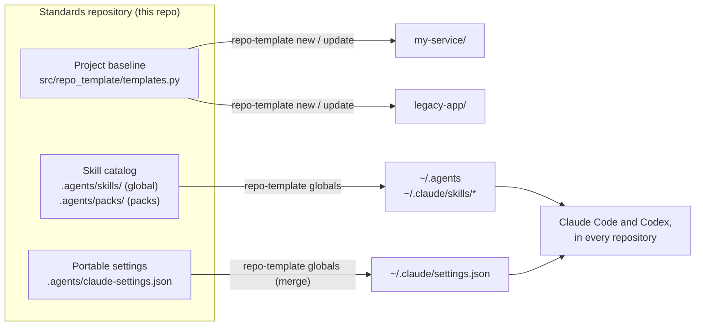
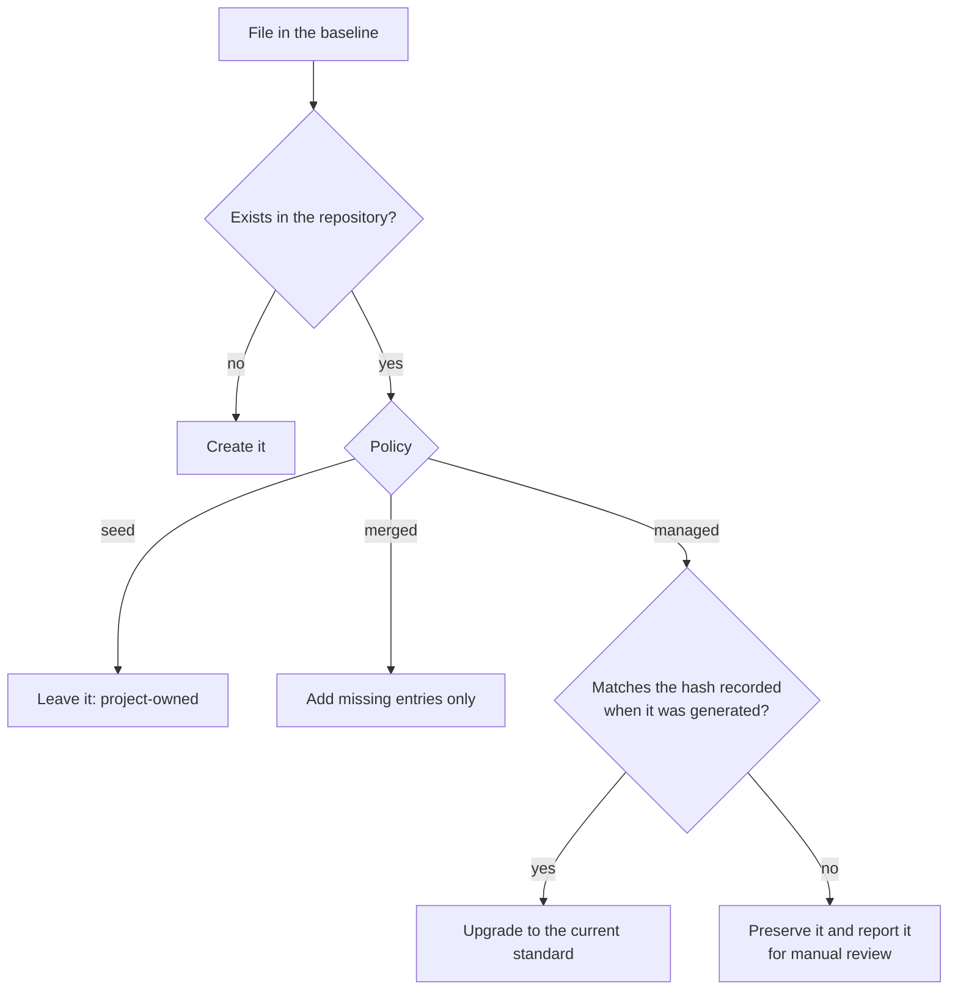
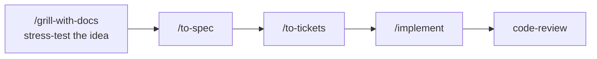

# repo-template

**One standard for every repository you start and every machine you code on, built so AI coding
agents (Claude Code, Codex) find what they need and do their best work.**

`repo-template` is two things that belong together:

1. **A CLI that creates and safely updates Python/uv repositories.** A new repository comes out
   ready to work in: uv, pytest, Ruff, strict mypy, CI, Dependabot, a pre-commit secret scan,
   a pre-push hook that fills in pull request descriptions, and the context files agents read
   first (`AGENTS.md`, `GLOSSARY.md`, `docs/adr/`). Existing
   repositories move toward the same standard without losing local changes.
2. **A versioned catalog of agent skills and settings.** `.agents/skills/` (and `.agents/packs/`
   for skills only some repositories want) holds the skills you rely on: test-driven development, bug diagnosis, architecture review, spec → tickets →
   implementation, code review, LangChain/LangGraph, evals and more. One command links them
   into Claude Code and Codex on any machine.

## Why this exists

AI agents are only as good as the repository they land in and the workflows they're given.

- **Agents need context in predictable places.** An `AGENTS.md` with the real commands and the
  system's purpose and boundaries, a `GLOSSARY.md` of domain terms, and ADRs that explain past
  decisions give an agent the context a new teammate would ask for. Skills such as
  `domain-modeling`, `codebase-design`, `improve-codebase-architecture` and `grill-with-docs`
  read and write exactly these files.
  Every generated repository has them.
- **Agents need a fast, strict feedback loop.** `tdd` and `diagnosing-bugs` work only when tests,
  lint and type checks fail loudly. Every repository gets the same `pytest` / `ruff` /
  `mypy --strict` loop, enforced by a pre-commit hook and CI.
- **Copied templates rot.** Cookiecutter-style templates are copied once and then drift.
  `repo-template update` keeps bringing repositories forward, and because it records what it
  generated, it never overwrites a change you made.
- **Skills drift between machines.** Hand-copying `~/.claude/skills` leaves every laptop slightly
  different. Here the catalog is a Git repository: `git pull && repo-template globals` makes
  machines identical, while credentials, history and caches stay local.

## How it works



### Who owns each generated file

Every file in the project baseline has a policy that decides what `update` may do to it.

| Policy | Files | What `update` does |
| --- | --- | --- |
| **Managed** | CI workflow, Dependabot, PR template, pre-commit and pre-push hooks, `.editorconfig`, `.gitattributes`, `.python-version`, `CLAUDE.md` | Upgrades the file to the current standard **only if** it is unchanged since it was generated. Edited files are left alone and reported. |
| **Seed** | `README.md`, `AGENTS.md`, `GLOSSARY.md`, `CHANGELOG.md`, `.env.example`, issue templates, `docs/adr/README.md`, package `__init__.py`, smoke test | Created whenever it is missing (also after you delete it), then the file is yours: `update` never changes one that exists. To delete one for good, add it to `project_owned`. |
| **Merged** | `pyproject.toml`, `.gitignore`, `.vscode/*.json` | Adds what is missing and never removes anything: dev dependencies and tool tables in `pyproject.toml`, a marked block in `.gitignore`, missing keys, extension recommendations and tasks in VS Code files. Project metadata and dependencies are not touched. |

Each generated repository commits a `.repo-template.json` manifest that records the template
version, the project variables, and a SHA-256 of every managed file as generated. That hash is
how `update` tells "unchanged since generation, safe to upgrade" from "you edited this, leave it".



Running `update` a second time changes nothing.

### Global linking: portable files only, never machine state

`repo-template globals`:

- links `~/.agents` → `<standards>/.agents` (Codex and the `npx skills` CLI read global skills
  from here);
- merges the portable settings in `<standards>/.agents/claude-settings.json` into a real
  `~/.claude/settings.json` (see below);
- creates one link per skill that isn't in a skill pack,
  `~/.claude/skills/<name>` → `<standards>/.agents/skills/<name>`, and removes links to skills
  that were deleted or moved into a pack;
- keeps this repository's `.claude/skills/` mirror in step with the catalog (relative links, so
  they work on every machine);
- adds `.agents/`, `.claude/`, `.codex/`, `.playwright-cli/` and `.playwright-mcp/` to the
  global ignore file Git reads (`core.excludesFile` when set, in the system or global config or
  one they include, and expanded as Git expands it; else `$XDG_CONFIG_HOME/git/ignore`, else
  `~/.config/git/ignore`), in a marked block, so personal agent configuration never leaks into
  project repositories. Git is asked outside any repository, so an `includeIf` for some
  repositories doesn't decide it; the ignore file such an `includeIf` brings in (from the global
  config, a file it includes, or another included file) gets the block too. A relative
  `core.excludesFile` is reported, not guessed: as a problem for the file Git always reads, as a
  note for one it reads in some repositories. The always-read file being one you can't write (a
  system one) is an error naming it; a conditional one gets a note. A linked file is written
  through, and a block that lost a marker line, or has them out of order, is left alone.

It never links `~/.claude` itself, so credentials, sessions, history, caches and Claude's
`synced` directory stay on the machine. Anything it replaces is first moved to
`~/.repo-template/backups/<timestamp>/`.

### Portable settings: merged, not linked

`.agents/claude-settings.json` has three parts:

- `portable`: owned by repo-template and kept current on every machine, entry by entry. Each
  plugin switch, environment variable (telemetry opt-outs) and marketplace, each permission rule
  (deny reading `.env` and key files at any depth, ask before destructive Docker commands and
  before `playwright-cli run-code`), and each hook, identified by its event, matcher and command
  (the skill receipts, which always end in `|| true`).
- `defaults`: model, effort level, theme, notifications (only machine preferences are accepted
  here). Each one is written once, when a machine doesn't have it, and never again: after that it
  belongs to the machine (`/model` and `/config` write it), even if you remove it.
- `linked`: what the pre-0.4.2 link distributed, used once to migrate that link (below).

`globals` merges `portable` into `~/.claude/settings.json` and records what it wrote in
`~/.repo-template/globals-state.json`, so it can tell a change in the standards from a change you
made on this machine:

- an entry still as `globals` wrote it takes the new portable value, including `false` and
  removals;
- an entry you changed here is kept and reported under **Preserved for manual review**, as
  `! … enabledPlugins.<plugin> (changed on this machine; kept)`,
  `! … permissions.deny <rule> (removed on this machine)` or
  `! … hooks.<event> <matcher or *> <command> (changed on this machine; kept)`. That run exits
  `2`; later runs are quiet until the standard's value for that entry changes, which is reported
  once more;
- everything else in the file is never touched: your own plugins, rules and hooks (also hooks
  you add inside a portable matcher group), and values you already had before your first
  `globals` run.

To **change a portable setting for every machine**, edit `.agents/claude-settings.json` here,
commit, then `git pull && repo-template globals` elsewhere. A `/plugin` toggle or a hand edit of
`~/.claude/settings.json` stays on that machine. To **take the standard's value back** for an
entry you changed, set it to the value in `.agents/claude-settings.json` (or re-add the removed
rule): `globals` then treats it as current again. To **start over**, delete
`~/.repo-template/globals-state.json` together with every portable entry (or whole `enabledPlugins`,
`permissions` and `hooks` sections) in `~/.claude/settings.json`; the next run writes them again as
its own. Entries you leave in place after deleting the state file count as this machine's, and
defaults you removed are written again.

`permissions.allow` and settings that widen access to the machine, such as
`remoteControlAtStartup`, are never distributed: `globals` refuses a source that contains them.
A link at `~/.claude/settings.json` that repo-template didn't create (dotfiles, stow) is left
alone and reported once.

#### Upgrading a machine from a linked settings file (before 0.4.2)

Before 0.4.2, `~/.claude/settings.json` was a link to `.claude/settings.json` in this repository,
so Claude Code wrote `/model`, `/effort` and `/plugin` changes from every machine into that shared
file. That file is gone in 0.4.2. On each machine:

```bash
link=$(readlink ~/.claude/settings.json) &&      # <checkout>/.claude/settings.json
  cd "${link%/.claude/settings.json}" &&          # this repository's checkout
  cp .claude/settings.json ~/claude-settings-before-0.4.2.json &&   # this machine's view
  git checkout -- .claude/settings.json &&        # changes written through the link block the pull
  git pull &&                                     # removes .claude/settings.json: the link dangles
  cp ~/claude-settings-before-0.4.2.json .claude/settings.json &&   # Git ignores it now
  repo-template globals && rm .claude/settings.json
```

Putting the saved copy back before `globals` lets the migration see this machine's settings
through the link. It then backs up that content and the link target under
`~/.repo-template/backups/<timestamp>/`, writes a real file, and keeps everything the old shared
file didn't distribute (your own plugins, rules, hooks, `model`, `remoteControlAtStartup`). If you
skip that step, the dangling link is treated like a fresh machine: every portable entry and
default is written, and nothing of the old file is kept. Between the pull and `globals`, Claude
Code on that machine has no user settings: no deny rules, plugins or receipt hooks.

## Quick start

### Install (once per machine)

Run [`setup-machine.sh`](setup-machine.sh) on macOS or Linux: download it, read it, run it. It
asks where this repository goes (`~/aiDevStandards` on a new machine), installs the CLI, applies
`globals` once you agree, and offers the per-machine tools. Run it again any time to update;
`--check` reports what is set up and what isn't, and changes nothing.

```bash
curl -fsSLO https://raw.githubusercontent.com/bennwitt/repo-template/main/setup-machine.sh
less setup-machine.sh && bash setup-machine.sh
```

`repo-template --version` prints the version and the standards repository the CLI runs from.

[HOW_TO_UPDATE_MACHINE_AND_ITS_REPOS.md](HOW_TO_UPDATE_MACHINE_AND_ITS_REPOS.md) has the
prerequisites, the per-machine tools for each OS, the same setup by hand, and how to update or
adopt your repositories.

The CLI is an editable install, so a `git pull` updates it and its templates without a
reinstall. `globals` finds this repository through `--standards-root`, else `AI_DEV_STANDARDS`
(the setup script sets it in your shell profile), else the checkout the CLI is installed from.
A root named either way must be a standards repository, or the command stops with an error, so
running it inside some other repository (which may well have `.agents/skills/` of its own, from
`npx skills add`) never relinks `~/.agents` there. With neither set, if you're inside a second
repo-template checkout, it stops and asks you to pass `--standards-root`. To work on another
checkout of this repository, name it: `repo-template globals --standards-root .`.

### Per-machine tools

The portable settings turn on plugins that need tools on each machine (language servers, the
Playwright CLI, `az` and `azd`, a GitHub token for the `github` plugin), and some skills drive
CLIs. `.agents/machine-tools.json` pins each one once, to its newest final release at least 7
days old (a short supply-chain cooldown); `below` keeps one under a major version the machines
can't run yet, a `pinException` says why a release inside its cooldown is pinned, and `azd`'s
entry records each platform's release asset with its SHA-256. The setup script offers each tool
at its pin, with npm's `--before` set to the end of the newest pin's day so dependencies wait out
the cooldown too, and installs `azd` only once the download's SHA-256 matches; [section 1.1 of the guide](HOW_TO_UPDATE_MACHINE_AND_ITS_REPOS.md#11-optional-tools)
lists them with the macOS and Linux commands. `globals --upstream` reports a newer release past
the cooldown, and an `azd` asset whose digest on GitHub differs from the recorded one; move a
pin by editing its `version` and `publishedAt` (and each asset's `sha256`), in the same commit
as the guide's commands. The Azure CLI is the exception: Homebrew and Microsoft's packages
install the current release.

- `typescript-language-server` 6 needs Node 22.22 or later; 5.3 is the newest that runs on Node
  20, which is past its end of life. TypeScript 7 is the native compiler and has no `tsserver`,
  so the language server needs TypeScript 6.
- The `github` plugin fails to connect with "Authorization header is badly formatted" until
  `GITHUB_PERSONAL_ACCESS_TOKEN` is set in the environment Claude Code starts in. The token
  never goes in this repository.
- The Azure skills run `az` and `azd`, and the MCP server signs in through `az login`
  (`AZURE_TOKEN_CREDENTIALS=AzureCliCredential`); nothing stores an Azure key. The server is
  read-only; deploys, deletes, role assignments, admin consent, credential resets, extension
  installs and commands that print keys ask first (portable `permissions.ask`).

### Create a repository

```bash
repo-template new my-service --parent ~/code --description "Processes customer jobs."
cd ~/code/my-service
uv run pytest
```

`new` normalizes the name (`My Service` becomes the project `my-service` with package
`my_service`), refuses to write into a non-empty directory, runs `git init -b main`, points
`core.hooksPath` at `.githooks/`, and creates `uv.lock`. `--python 3.13` changes the Python
version (default `3.12`). Use `--no-git` or `--no-lock` only when another system owns those
steps.

### Bring an existing repository up to standard

```bash
repo-template check  /path/to/repo   # dry run: lists what would change, writes nothing
repo-template update /path/to/repo   # apply, then decide each file that differs
repo-template check  ~/code/*/       # several repositories: one summary line each
```

`update` creates what's missing, merges `pyproject.toml`, `.gitignore` and the VS Code files,
configures the Git hook path (skip with `--no-hooks`), and creates or refreshes `uv.lock` when
`pyproject.toml` changed (skip with `--no-lock`). `check` plans the same steps and also reports
`.repo-template.json` when it is out of date (a new template version, a stale hash), so a clean
`check` means `update` has nothing to do. While other files are out of date too, it lists the
manifest whenever its hashes would change.

A manifest written by a newer `repo-template` than the one you're running stops both commands:
`git pull` the standards repository first, so an out-of-date machine can't downgrade a repository.

#### Deciding files that differ

A file that exists and differs from the baseline is never changed silently. In a terminal,
`update` shows a diff of yours against the baseline and asks what to do:

| Choice | Effect |
| --- | --- |
| `o` use the baseline | Replace your file with the baseline's version. |
| `k` keep yours | Keep it, and record in `.repo-template.json` that you accepted this difference. You're asked again only when the baseline's version of the file changes. |
| `m` merge change by change | For each place the two differ: take the baseline's (`y`), keep yours (`n`), or keep both (`b`). A result that differs from the baseline is recorded like `k`. |
| `a` always keep yours | Add the file to `project_owned` in `.repo-template.json`; `update` leaves it alone for good, and doesn't recreate it if you delete it. |
| `s` skip for now | Leave it; `update` asks again next time. |

A merged file that `update` can't merge into (`pyproject.toml` or `.vscode/*.json` that doesn't
parse) offers only keep, always keep or skip: the baseline's version of it is a bare template that
would replace your project's metadata and dependencies, or your editor settings. Fix it by hand
and run `update` again.

A file under an old name (`CONTEXT.md` is now `GLOSSARY.md`, and a `CLAUDE.md` holding the agent
guide moves to `AGENTS.md`) can be moved for you: with `git mv` when the file is tracked, so its
history follows. `update` then lists the lines that still mention the old name. Commit the
staged moves on their own before anything else to keep that history.

Every decision is applied as you make it, so stopping halfway (Ctrl-C) loses nothing. Without a
terminal (scripts, CI, agents), or with `--no-input`, `update` lists the files under
**Preserved for manual review** and exits with `2`; the `repo-template` skill walks an agent
through the same decisions.

#### Adopting a repository the baseline didn't generate

`update` infers the name, description and Python version from `pyproject.toml`, and adapts to
what is already there:

- code that lives in `src/` but not in `src/<package>/` keeps its layout: no package scaffold,
  smoke test or `[tool.mypy]` table that would name a package the repository doesn't have;
- a tool the project already configures (any `[tool.ruff…]`, `[tool.pytest…]` or `[tool.mypy]`
  table) keeps its settings, since adding even a line length changes how it formats code;
- a `CLAUDE.md` that holds the agent guide is offered a move into `AGENTS.md`, instead of
  `update` creating a generic `AGENTS.md` beside it;
- every managed file that differs comes up for a decision, because there's no generation hash
  to prove it unedited.

#### Packs only: a repository that isn't Python/uv

A repository with other tooling (a TypeScript app, say) can take just the skill packs and their
MCP servers:

```bash
repo-template update /path/to/web-app --packs-only --pack react
```

That writes a `.repo-template.json` whose `profile` is `packs-only`, the pack links, and the
packs' MCP servers (`.mcp.json`, and an ignored `.codex/config.toml`): no baseline file, hook path
or lockfile. Later `update` and `check` follow the recorded profile, so the flag is needed only
the first time, and `--pack` adds more. `check <repo> --packs-only --pack react` shows what it
would do first. It is refused for a repository on the Python/uv baseline, and for a
`.repo-template.json` another tool wrote, which it never overwrites; every refusal comes before
anything is written. To move a packs-only repository onto the Python/uv baseline later, delete
its `.repo-template.json` and run `update`.
Links are made only where Git ignores them: on a machine where `globals` ran, its global excludes
ignore `.agents/`, `.claude/` and `.codex/` in every repository; elsewhere the repository's own
`.gitignore` needs them, and `update` reports each link it couldn't make.

#### Personal: a repository you don't manage

In a team's repository, your skill packs and MCP servers are yours alone. `--personal` adopts it
without changing anything the team sees: nothing is committed, and `git status` stays as it was.

```bash
repo-template update /path/to/team-app --personal --pack react --pack playwright
```

- The manifest is `.git/repo-template.json`, inside the clone's own `.git` folder.
- The links it makes are listed in a repo-template block in `.git/info/exclude`, the clone's own
  ignore file, so they don't depend on the global excludes. Each line ignores only the link: a
  folder of the team's that replaces it after a pull shows as usual.
- The packs' servers go to Claude Code's local scope for this checkout (`~/.claude.json`, used
  only by you), never to `.mcp.json`, and to Codex in `.codex/config.toml`, which the block
  ignores. It goes only into a `.codex/config.toml` that holds nothing else, or one the
  repository's `.gitignore` ignores: never into one the repository tracks, or one with settings
  of your own that only your own rules might hide. If you add settings to the file later, the
  block comes out, and the file shows in `git status` like any file of yours.
- A path the repository tracks is never linked, listed or removed: a team skill with a pack
  skill's name is noted and left alone. A server the repository's `.mcp.json` defines is the
  team's, so the pack's isn't added.
- Every run checks again: a link or Codex block that Git would no longer ignore (the team
  changed its `.gitignore`) is taken out and reported.

Later runs follow the recorded profile, as with packs only. To drop packs, edit `skill_packs` in
`.git/repo-template.json` and run `update`. To undo it entirely, set `skill_packs` to `[]`, run
`update` (it removes the links, the block, the Codex block and your local-scope servers), then
delete `.git/repo-template.json`; deleting it first leaves all of those behind.

It needs the top folder of a main checkout, and any run in a linked worktree of one is refused:
Git shares `info/exclude` with linked worktrees (so the Codex line applies there too), and
Claude Code keys local scope by the main checkout, so its servers show there as well, while the
skill links don't. It is refused too once the repository has a `.repo-template.json` of its own;
the error says how to undo the personal adoption first; in a sparse checkout, where a team
file outside the checkout can land on a link or the Codex file; and in a subfolder of a personal
checkout, unless that subfolder has a `.repo-template.json` of its own. `git clean -fdx` deletes
the links and the Codex file like any ignored file; `update` puts them back.

### Exit codes

| Command | `0` | `1` | `2` |
| --- | --- | --- | --- |
| `new` | created | created, but a Git or uv step failed | n/a |
| `update` | applied cleanly | an error was reported: a Git or uv step failed, or a listed skill pack isn't defined or lists a skill that isn't installed | files preserved for manual review |
| `check` | current (every path, when given several) | something would change, or an error was reported | n/a |
| `globals` | applied cleanly | an error was reported (for example an override for a missing skill, or settings that aren't valid JSON) | something was preserved: a portable setting or an MCP server entry changed or removed on this machine (reported once), a link at `~/.claude/settings.json` that repo-template didn't create, or a real folder in this repository's `.claude/skills/` mirror where a skill link belongs |
| `globals --check` | current | a link or setting would change, or something is reported for review (once: a setting changed on this machine, a link repo-template didn't create) | n/a |
| `globals --upstream` | every vendored skill and MCP pin is current | a skill changed upstream, or an MCP pin has a newer release past its cooldown | something needs review: a skill removed or moved upstream, a license text changed, a recorded commit that doesn't hold the vendored folder, or an MCP pin that was yanked, is recorded with the wrong time, or is younger than the cooldown without a `pinException` (or no longer needs one) |
| `globals --upgrade` (`130` if interrupted, after listing what it applied) | applied, or nothing to do | a skill was refused (it failed verification or the scan, or runs commands when it loads), or an error was reported | a skill was left as it is (skipped, kept though gone upstream, or with `--no-input` not named or not ready to apply unattended), or something was preserved while linking |

Every command also exits `1` with a `repo-template: error: …` line when it can't run at all: an
unknown pack, an unreadable manifest, a non-empty target for `new`, or a manifest from a newer
version. `globals --upstream` and `--upgrade` exit `3` when GitHub (or, for `--upstream`, npm or
PyPI) can't be reached or refuses a request; a repository, ref or folder that is gone (404) is
reported for that skill instead. Exit `2` otherwise means only "preserved for manual review" (and
command-line usage errors, which print the usage). When a run has both errors and preserved files, errors win and
the exit is `1`: fix what failed, rerun, then decide the preserved files.

With several paths, `check` prints one line per repository on stdout, such as
`../svc: current (0.4.1)` or `../api: 1 to create, 2 to update, 1 for review (0.3.0)` (the
version recorded in its manifest), and each error as a `repo-template: error: <path>: …` line on
stderr.

This makes the CLI easy to script, for example `repo-template check . || echo "standards drifted"`.

## What a generated repository contains

```text
my-service/
├── AGENTS.md              # purpose, boundaries, commands and working agreements for any agent
├── CLAUDE.md              # "@AGENTS.md": Claude reads the same guide as Codex
├── GLOSSARY.md            # domain terms only, kept by the domain-modeling skill
├── docs/adr/              # architecture decision records
├── README.md, CHANGELOG.md
├── pyproject.toml         # uv_build, pytest, Ruff, mypy --strict
├── src/my_service/        # __init__.py, py.typed
├── tests/test_smoke.py
├── .githooks/pre-commit   # secret scan, uv lock --check, ruff, mypy, pytest
├── .githooks/pre-push     # fills in the pull request's description after each push
├── .github/               # CI, Dependabot (uv and Actions), PR and issue templates
├── .vscode/               # interpreter, pytest, Ruff on save, tasks
├── .env.example           # .env, *.pem and *.key are ignored
├── .ai/receipt-policy.json # turns on skill receipts (see below)
└── .repo-template.json    # ownership manifest: commit it
```

## The skill catalog

Global skills live in `.agents/skills/<name>/SKILL.md`, pack skills in
`.agents/packs/<name>/SKILL.md` (see below). `.claude/skills/` in this repository is a mirror of
symlinks to the global ones, so they appear when you open this repository in Claude Code.

A skill with `disable-model-invocation: true` runs only when you type `/name`, so it costs no
context until you use it. The others are listed in every session so the agent can pick them up
on its own. Claude Code's `/skill-doctor` shows each skill's per-turn context cost and how often
it is used; run it occasionally and prune what you never use.

### Engineering workflow

A typical feature moves through these skills:



| When you want to… | Use |
| --- | --- |
| Bring a repository to this standard | `repo-template` (this repository's own skill: check, update, resolve preserved files, packs) |
| Find the right skill or flow | `/ask-matt` |
| Stress-test a plan | `grilling`, `/grill-me`, `/grill-with-docs` (also writes ADRs and glossary terms) |
| Turn a discussion into work | `/to-spec`, `/to-tickets`, `/wayfinder` (work larger than one session) |
| Build | `/implement`, `/implement-spec`, `tdd`, `prototype` |
| Fix a hard bug or regression | `diagnosing-bugs` |
| Stop and question an approach | `/wait-what` |
| Improve structure | `/improve-codebase-architecture`, `codebase-design`, `domain-modeling` |
| Review changes | `code-review` (against repository standards and against the spec) |
| Describe a PR | `pr` |
| Manage issues | `/triage`, `/to-questionnaire` |
| Pause and resume | `/handoff`, `/claude-handoff` |
| Write | `writing-for-agents`, `/writing-fragments`, `/writing-shape`, `/writing-beats` |
| Research, learn, reflect | `research`, `/teach`, `/loop-me`, `/retro` |
| Steps only a human can do | `wizard` |

Run `/setup-matt-pocock-skills` once in each repository. It records where issues are tracked,
the triage label names, and the domain-doc layout in `docs/agents/*.md`, which `to-spec`,
`to-tickets` and `triage` read.

`git-guardrails-claude-code` is frozen upstream with two known bypasses (`git -C <dir> push`, and
no blocking at all without `jq`), so treat it as a reminder, not a guarantee.

### Skill packs: domain skills only where they apply

A skill's description is listed in every session, so a LangChain skill costs context in a repository
that has nothing to do with LangChain, and its broad triggers can fire there. Skills that only make
sense in some repositories are grouped into packs in `.agents/skill-packs.json`, and live in
`.agents/packs/` rather than `.agents/skills/`. `globals` doesn't link them into `~/.claude/skills`,
and Codex, which reads `~/.agents/skills` on its own, never sees them there; a repository opts in
instead:

```bash
repo-template new my-agent --pack langchain        # start with a pack
repo-template update /path/to/repo --pack gradio   # add one later (also applies the baseline)
```

The pack is recorded under `skill_packs` in `.repo-template.json`, and `update` links each of its
skills into the repository's `.claude/skills/` (for Claude Code) and `.agents/skills/` (for Codex),
as links to `~/.agents/packs/`. To drop a pack, remove it from `skill_packs` and run `update`; its
links are removed and nothing else in either folder is touched. Links from before pack skills
moved to `.agents/packs/` are repointed by the next `update`. On another machine, `update`
recreates the links. If `skill_packs` lists a pack that `skill-packs.json` no longer defines
(renamed, or a machine that hasn't pulled), `update` reports it and removes no links at all, since
it can't tell which ones belonged to that pack.

`update` only makes links it can own, and reports the rest for you to decide:

- A link is made only where Git ignores it (generated repositories ignore both folders), so a
  link to this machine's catalog is never committed.
- A file, a folder, or a link it didn't make (such as `npx skills add` leaves) keeps its name.
- Nothing is linked into a folder that resolves outside the repository, or into the catalog
  (a repository whose `.agents` is a link to `~/.agents`); `check` keeps reporting it.
- Codex reads a repository's `.agents/skills` from the Git root down to the folder it runs in.
  Without a `.git` folder (`new --no-git`) it sees pack skills only when run from the root.

A skill can belong to several packs; it's linked once. A skill lives in `.agents/packs/` exactly
when some pack lists it, and integrity says which `git mv` to run when that changes.

### MCP servers: global and per pack

`.agents/mcp-servers.json` defines each MCP server once: what it runs (a pinned `npx`/`uvx`
package or a URL), for which clients, which of its tools are denied, and why it's here. A
**global** server is installed on every machine by `globals`; a **pack** server comes with a
pack (`"mcp": [...]` in `.agents/skill-packs.json`, optionally with extra `--flag` values).

The catalog refuses what it can't vouch for:

- a command other than `npx` or `uvx`, and args that don't run the pinned package first
  (`npx -y package@version`, `uvx --from package==version <tool>`): no `--package`, `--with`
  or `--index` that would run something else;
- a pin less than 7 days old without a `pinException` giving the reason: `globals --check`
  reports it, `globals` and `update` don't install that server, and `--upstream` says when an
  exception can go;
- a flag that widens access (`--dangerously-*`, `--insecure-*`, a `--transport` other than
  stdio, a value after `--read-only`), and pack args other than the flags the server lists in
  `packArgs` (so a pack can add `--namespace`, never undo `--read-only`);
- a tenant, subscription or client ID (a GUID, `AZURE_SUBSCRIPTION_ID`, `--subscription`):
  each machine has its own, through `az login` or its environment;
- anything that looks like a secret: env names like `*_TOKEN`, `*_PAT` or `*AUTH*`, secret-like
  flags or values in args (pack args included), and credentials or a query in a URL. Servers
  are keyless and read-only.

| Where | Claude Code | Codex |
| --- | --- | --- |
| global | user scope (`~/.claude.json`), through `claude mcp add-json --scope user` | `~/.codex/config.toml` |
| pack | the repository's `.mcp.json` (committed; Claude Code asks before it starts one) | the repository's `.codex/config.toml` (ignored by Git; Codex reads it only in a project you trust) |
| pack, personal repository | local scope for that checkout (`~/.claude.json`), through `claude mcp add-json --scope local` | the repository's `.codex/config.toml`, as above |

- Each client gets its own rendering. Claude Code gets `${NAME:-default}` for each default, so
  a machine can override it by exporting `NAME`; Codex expands nothing, so it gets the value.
- A pinned `npx` server runs with `npm_config_before` set to its pin's date and an npm cache of
  its own, so the 7-day cooldown covers its dependencies on a first install too.
- A denied tool is denied in both clients: as `mcp__*__<tool>` in the portable settings (the
  catalog check fails if one is missing) and as `disabled_tools` in Codex.
- repo-template owns each entry by name and by a digest of what it wrote, recorded in
  `~/.repo-template/globals-state.json` for global servers (and, under
  `claude_mcp:local:<checkout>`, a personal repository's) and under `mcp_servers` in a
  repository's `.repo-template.json` for pack servers. An entry changed by hand is kept and
  reported once, one removed stays removed, and one no longer in the catalog (or that no pack
  uses) is removed only if it is unchanged. In a repository the kept and removed entries are
  recorded under `mcp_kept`; delete a name there to have repo-template manage it again (for a
  personal repository, delete `.git/repo-template.json` and adopt it again with `--personal`:
  a new adoption starts its record afresh). A config file that is gone
  (a new machine, a reset) starts fresh. `--check` reads the configs and runs nothing.
- In Codex's file, only a `[mcp_servers.<name>]` table is taken over; the same server written
  as an inline table or dotted keys is left as it is. A symlinked `~/.codex/config.toml` is
  written through. With `CLAUDE_CONFIG_DIR` set elsewhere, Claude Code's servers are skipped:
  it wouldn't read the deny rules in `~/.claude/settings.json`.
- An entry repo-template doesn't own that runs a server this client gets from it globally (the
  same URL or package) gets a note with the command that removes it.
- `.mcp.json` and `.codex/config.toml` can be taken over by listing them in `project_owned`. A
  `.codex` that is a link out of the repository is left alone, and while a listed pack isn't
  defined (renamed, or not pulled yet) neither file changes.

The `playwright` server replaces the `playwright` plugin, which the portable settings now turn
off: the plugin runs `@playwright/mcp@latest` with a persistent profile.

### Catalog: every skill, where it applies, and where it comes from

Generated by `repo-template globals` from the lock, the packs and `.agents/skill-sources.json`
(the full license texts are in [THIRD_PARTY_NOTICES.md](THIRD_PARTY_NOTICES.md)). "Global" skills
are linked on every machine; pack skills only in repositories that list the pack. Every vendored
skill is byte for byte the upstream folder in the lock, which `globals --check` and the tests
verify, and its Source links to the upstream commit recorded for that folder. The one sanctioned
difference is the frontmatter fields an override changes, which are marked in the SKILL.md
itself.

<!-- >>> repo-template catalog: generated by `repo-template globals`; don't edit -->
| Pack | What it's for | Skills |
| --- | --- | --- |
| `agent-evals` | Benchmarks and evals for agent repositories (Harbor tasks, verifiers, calibration) | `eval-engineering` |
| `api` | API design: REST resources and OpenAPI contracts, versioning, pagination and errors, and GraphQL schemas, resolvers and federation. | `api-designer`, `graphql-architect` |
| `atlassian` | Jira and Confluence through an Atlassian MCP server. It needs a sign-in, so connect one yourself (such as the Atlassian plugin); the pack ships none. | `atlassian-mcp` |
| `azure` | Azure: prepare, validate and deploy with azd, diagnostics, resource lookup, Storage, App Insights, Entra app registration and azure-identity. | `appinsights-instrumentation`, `azure-deploy`, `azure-diagnostics`, `azure-identity-py`, `azure-identity-ts`, `azure-prepare`, `azure-resource-lookup`, `azure-storage`, `azure-validate`, `entra-app-registration` |
| `cli` | Command-line tools: subcommands and flags, interactive prompts, progress output and shell completion. | `cli-developer` |
| `databases` | PostgreSQL and SQL: writing and reviewing queries, schema and index design, execution plans and tuning. | `database-optimizer`, `postgres-pro`, `sql-pro` |
| `dev-workflows` | Alternative workflows from jeffallan/claude-skills for code review, debugging, tests, architecture and ADRs, requirements, devil's advocate and secure full-stack features. They overlap the global code-review, diagnosing-bugs, tdd, codebase-design, to-spec and grilling, so add the pack only where you want them. | `architecture-designer`, `code-reviewer`, `debugging-wizard`, `feature-forge`, `fullstack-guardian`, `test-master`, `the-fool` |
| `fastapi` | FastAPI services for agents: tests, lifespan, auth, CORS, Open WebUI tool servers, and an OpenAI-compatible chat endpoint in front of a graph. | `fastapi-expert`, `fastapi-services` |
| `foundry` | Microsoft Foundry: agents, models, evaluation and the Foundry SDK, through the Azure MCP foundry tools. | `azure-ai`, `azure-ai-projects-ts`, `foundry-langchain`, `microsoft-foundry` |
| `golang` | Go services: goroutines and channels, interfaces and generics, gRPC or REST, testing and pprof. | `golang-pro` |
| `gradio` | Building Gradio apps and calling Gradio apps through their API | `frontend-design`, `gradio`, `hf-gradio` |
| `knowledge-graph` | Extracting knowledge graphs from text | `knowledge-graph-extraction` |
| `langchain` | LangChain, LangGraph, Deep Agents and LangSmith (langchain-ai/langchain-skills) | `deep-agents-core`, `deep-agents-memory`, `deep-agents-orchestration`, `deepagents-python-quickstart`, `deepagents-typescript-quickstart`, `ecosystem-primer`, `langchain-dependencies`, `langchain-fundamentals`, `langchain-middleware`, `langchain-python-quickstart`, `langchain-rag`, `langchain-typescript-quickstart`, `langgraph-cli`, `langgraph-fundamentals`, `langgraph-human-in-the-loop`, `langgraph-persistence`, `langgraph-python-quickstart`, `langgraph-typescript-quickstart`, `managed-deep-agents` |
| `local-inference` | Local models on a workstation GPU: vLLM, llama.cpp and Ollama, recipes, memory sizing, benchmarks, and Meta Muse Glimmer. | `hf-mem`, `huggingface-local-models`, `local-model-serving`, `model-recipes`, `muse-glimmer`, `vllm-bench-serve` |
| `mcp` | Writing MCP servers in Python: FastMCP or the official SDK, testing, transports, Open WebUI and evaluations. | `mcp-developer`, `mcp-servers`, `python-mcp-server-generator` |
| `ml-engineering` | Machine-learning engineering: training pipelines and experiment tracking, fine-tuning with LoRA or QLoRA, RAG systems, and prompt design and evaluation. | `fine-tuning-expert`, `ml-pipeline`, `prompt-engineer`, `rag-architect` |
| `openwebui` | Open WebUI as the chat front end for your own agents: connections, Pipes, Tools, Filters, tool servers and deployment. | `frontend-design`, `openwebui` |
| `playwright` | Playwright end-to-end tests: best practices and reading traces. | `playwright-best-practices`, `playwright-expert`, `playwright-trace` |
| `react` | React and shadcn/ui front ends; with the langchain pack, LangGraph useStream chat UIs. | `frontend-design`, `react-expert`, `react-native-expert`, `shadcn`, `vercel-composition-patterns`, `vercel-react-best-practices`, `web-interface-guidelines` |
| `security` | Secure coding and security review: authentication and authorization, input validation, the OWASP Top 10, and audit reports with remediation. | `secure-code-guardian`, `security-reviewer` |
| `spring-boot` | Spring Boot 3 services: REST controllers, Spring Security 6, Spring Data JPA and WebFlux. | `spring-boot-engineer` |
| `sre` | Reliability: SLOs and error budgets, incident response, monitoring, logging, alerting and tracing, and chaos experiments. | `chaos-engineer`, `monitoring-expert`, `sre-engineer` |
| `typescript` | TypeScript repositories (deep-module boundaries, shoehorn test data) | `migrate-to-shoehorn`, `setup-ts-deep-modules`, `typescript-pro` |
| `vision` | Computer vision in Python: OpenCV, and Meta SAM 3 segmentation. | `opencv-python`, `sam3` |

| Skill | Where | Source | License | Notes |
| --- | --- | --- | --- | --- |
| `api-designer` | pack `api` | [jeffallan/claude-skills](https://github.com/jeffallan/claude-skills/tree/36f3fe8052da7c57083783268c6ea3265d075265/skills/api-designer) | MIT |  |
| `appinsights-instrumentation` | pack `azure` | [microsoft/azure-skills](https://github.com/microsoft/azure-skills/tree/5aa6e04819634ca4945ef57d6aa059eb4f5944e7/skills/appinsights-instrumentation) | MIT |  |
| `architecture-designer` | pack `dev-workflows` | [jeffallan/claude-skills](https://github.com/jeffallan/claude-skills/tree/36f3fe8052da7c57083783268c6ea3265d075265/skills/architecture-designer) | MIT |  |
| `ask-matt` | global | [mattpocock/skills](https://github.com/mattpocock/skills/tree/49dd158d1076134a641b33efb035946536778336/skills/engineering/ask-matt) | MIT | runs only as `/ask-matt` |
| `atlassian-mcp` | pack `atlassian` | [jeffallan/claude-skills](https://github.com/jeffallan/claude-skills/tree/36f3fe8052da7c57083783268c6ea3265d075265/skills/atlassian-mcp) | MIT |  |
| `azure-ai` | pack `foundry` | [microsoft/azure-skills](https://github.com/microsoft/azure-skills/tree/5aa6e04819634ca4945ef57d6aa059eb4f5944e7/skills/azure-ai) | MIT |  |
| `azure-ai-projects-ts` | pack `foundry` | [microsoft/skills](https://github.com/microsoft/skills/tree/fc164ba1d7a0c10377dbcc1c9ac07253b9329fdb/.github/plugins/azure-sdk-typescript/skills/azure-ai-projects-ts) | MIT |  |
| `azure-deploy` | pack `azure` | [microsoft/azure-skills](https://github.com/microsoft/azure-skills/tree/5aa6e04819634ca4945ef57d6aa059eb4f5944e7/skills/azure-deploy) | MIT | description overridden |
| `azure-diagnostics` | pack `azure` | [microsoft/azure-skills](https://github.com/microsoft/azure-skills/tree/5aa6e04819634ca4945ef57d6aa059eb4f5944e7/skills/azure-diagnostics) | MIT | description overridden |
| `azure-identity-py` | pack `azure` | [microsoft/skills](https://github.com/microsoft/skills/tree/fc164ba1d7a0c10377dbcc1c9ac07253b9329fdb/.github/plugins/azure-sdk-python/skills/azure-identity-py) | MIT |  |
| `azure-identity-ts` | pack `azure` | [microsoft/skills](https://github.com/microsoft/skills/tree/fc164ba1d7a0c10377dbcc1c9ac07253b9329fdb/.github/plugins/azure-sdk-typescript/skills/azure-identity-ts) | MIT |  |
| `azure-prepare` | pack `azure` | [microsoft/azure-skills](https://github.com/microsoft/azure-skills/tree/5aa6e04819634ca4945ef57d6aa059eb4f5944e7/skills/azure-prepare) | MIT | description overridden |
| `azure-resource-lookup` | pack `azure` | [microsoft/azure-skills](https://github.com/microsoft/azure-skills/tree/5aa6e04819634ca4945ef57d6aa059eb4f5944e7/skills/azure-resource-lookup) | MIT | description overridden |
| `azure-storage` | pack `azure` | [microsoft/azure-skills](https://github.com/microsoft/azure-skills/tree/5aa6e04819634ca4945ef57d6aa059eb4f5944e7/skills/azure-storage) | MIT | description overridden |
| `azure-validate` | pack `azure` | [microsoft/azure-skills](https://github.com/microsoft/azure-skills/tree/5aa6e04819634ca4945ef57d6aa059eb4f5944e7/skills/azure-validate) | MIT | description overridden |
| `chaos-engineer` | pack `sre` | [jeffallan/claude-skills](https://github.com/jeffallan/claude-skills/tree/36f3fe8052da7c57083783268c6ea3265d075265/skills/chaos-engineer) | MIT |  |
| `claude-handoff` | global | [mattpocock/skills](https://github.com/mattpocock/skills/tree/49dd158d1076134a641b33efb035946536778336/skills/in-progress/claude-handoff) | MIT | runs only as `/claude-handoff` |
| `cli-developer` | pack `cli` | [jeffallan/claude-skills](https://github.com/jeffallan/claude-skills/tree/36f3fe8052da7c57083783268c6ea3265d075265/skills/cli-developer) | MIT |  |
| `code-documenter` | global | [jeffallan/claude-skills](https://github.com/jeffallan/claude-skills/tree/36f3fe8052da7c57083783268c6ea3265d075265/skills/code-documenter) | MIT |  |
| `code-review` | global | [mattpocock/skills](https://github.com/mattpocock/skills/tree/49dd158d1076134a641b33efb035946536778336/skills/engineering/code-review) | MIT |  |
| `code-reviewer` | pack `dev-workflows` | [jeffallan/claude-skills](https://github.com/jeffallan/claude-skills/tree/36f3fe8052da7c57083783268c6ea3265d075265/skills/code-reviewer) | MIT |  |
| `codebase-design` | global | [mattpocock/skills](https://github.com/mattpocock/skills/tree/d80fa0f4ebe0c5714af0adf8670336065233ecc6/skills/engineering/codebase-design) | MIT |  |
| `compose-gpu-serving` | global | this repository | MIT |  |
| `database-optimizer` | pack `databases` | [jeffallan/claude-skills](https://github.com/jeffallan/claude-skills/tree/36f3fe8052da7c57083783268c6ea3265d075265/skills/database-optimizer) | MIT |  |
| `debugging-wizard` | pack `dev-workflows` | [jeffallan/claude-skills](https://github.com/jeffallan/claude-skills/tree/36f3fe8052da7c57083783268c6ea3265d075265/skills/debugging-wizard) | MIT |  |
| `deep-agents-core` | pack `langchain` | [langchain-ai/langchain-skills](https://github.com/langchain-ai/langchain-skills/tree/d00eed0bf1b3debfb8e248f98037da7ad07a0972/config/skills/deep-agents-core) | MIT |  |
| `deep-agents-memory` | pack `langchain` | [langchain-ai/langchain-skills](https://github.com/langchain-ai/langchain-skills/tree/d00eed0bf1b3debfb8e248f98037da7ad07a0972/config/skills/deep-agents-memory) | MIT |  |
| `deep-agents-orchestration` | pack `langchain` | [langchain-ai/langchain-skills](https://github.com/langchain-ai/langchain-skills/tree/d00eed0bf1b3debfb8e248f98037da7ad07a0972/config/skills/deep-agents-orchestration) | MIT |  |
| `deepagents-python-quickstart` | pack `langchain` | [langchain-ai/langchain-skills](https://github.com/langchain-ai/langchain-skills/tree/514d17f139972d4513c4c01c799881a381567159/config/skills/deepagents-python-quickstart) | MIT |  |
| `deepagents-typescript-quickstart` | pack `langchain` | [langchain-ai/langchain-skills](https://github.com/langchain-ai/langchain-skills/tree/514d17f139972d4513c4c01c799881a381567159/config/skills/deepagents-typescript-quickstart) | MIT |  |
| `diagnosing-bugs` | global | [mattpocock/skills](https://github.com/mattpocock/skills/tree/49dd158d1076134a641b33efb035946536778336/skills/engineering/diagnosing-bugs) | MIT |  |
| `docker-build-strategies` | global | [docker/skills](https://github.com/docker/skills/tree/f79172733725e2fd236343ee7b963c446ed85d09/skills/docker-build-strategies) | Apache-2.0 | description overridden |
| `docker-compose-patterns` | global | [docker/skills](https://github.com/docker/skills/tree/f79172733725e2fd236343ee7b963c446ed85d09/skills/docker-compose-patterns) | Apache-2.0 | description overridden |
| `docker-destructive-guardrails` | global | [docker/skills](https://github.com/docker/skills/tree/f79172733725e2fd236343ee7b963c446ed85d09/skills/docker-destructive-guardrails) | Apache-2.0 | description overridden |
| `domain-modeling` | global | [mattpocock/skills](https://github.com/mattpocock/skills/tree/d80fa0f4ebe0c5714af0adf8670336065233ecc6/skills/engineering/domain-modeling) | MIT |  |
| `ecosystem-primer` | pack `langchain` | [langchain-ai/langchain-skills](https://github.com/langchain-ai/langchain-skills/tree/9feb8147562f0f186b081b343e5ccaf53e9e7a18/config/skills/ecosystem-primer) | MIT |  |
| `entra-app-registration` | pack `azure` | [microsoft/azure-skills](https://github.com/microsoft/azure-skills/tree/5aa6e04819634ca4945ef57d6aa059eb4f5944e7/skills/entra-app-registration) | MIT | description overridden |
| `eval-engineering` | pack `agent-evals` | [langchain-ai/langchain-skills](https://github.com/langchain-ai/langchain-skills/tree/fc2010384ddb4f0ccc5317e25c82c246f7bc6bf7/config/skills/eval-engineering) | MIT |  |
| `fastapi` | global | [fastapi/fastapi](https://github.com/fastapi/fastapi/tree/f5c6e9b4f9cadc1bf0f9a1fd672e621206b63007/fastapi/.agents/skills/fastapi) | MIT | description overridden |
| `fastapi-expert` | pack `fastapi` | [jeffallan/claude-skills](https://github.com/jeffallan/claude-skills/tree/36f3fe8052da7c57083783268c6ea3265d075265/skills/fastapi-expert) | MIT |  |
| `fastapi-services` | pack `fastapi` | this repository | MIT |  |
| `feature-forge` | pack `dev-workflows` | [jeffallan/claude-skills](https://github.com/jeffallan/claude-skills/tree/36f3fe8052da7c57083783268c6ea3265d075265/skills/feature-forge) | MIT |  |
| `find-skills` | global | [vercel-labs/skills](https://github.com/vercel-labs/skills/tree/773fb2c7bbf16781670a3520affc4abd0c6151ae/skills/find-skills) | MIT | description overridden |
| `fine-tuning-expert` | pack `ml-engineering` | [jeffallan/claude-skills](https://github.com/jeffallan/claude-skills/tree/36f3fe8052da7c57083783268c6ea3265d075265/skills/fine-tuning-expert) | MIT |  |
| `foundry-langchain` | pack `foundry` | this repository | MIT |  |
| `frontend-design` | pack `gradio`, pack `openwebui`, pack `react` | [anthropics/skills](https://github.com/anthropics/skills/tree/dbd4588f9e1033efb41dad4bef2f7947c8993d44/skills/frontend-design) | Apache-2.0 |  |
| `fullstack-guardian` | pack `dev-workflows` | [jeffallan/claude-skills](https://github.com/jeffallan/claude-skills/tree/36f3fe8052da7c57083783268c6ea3265d075265/skills/fullstack-guardian) | MIT |  |
| `git-guardrails-claude-code` | global | [mattpocock/skills](https://github.com/mattpocock/skills/tree/321658273cb1d20b76026717d027d505790106d4/skills/misc/git-guardrails-claude-code) | MIT |  |
| `github-actions-hardening` | global | [github/awesome-copilot](https://github.com/github/awesome-copilot/tree/df566343b3a685e821f8ebe8ea70a2a8eb8b857b/skills/github-actions-hardening) | MIT | description overridden |
| `golang-pro` | pack `golang` | [jeffallan/claude-skills](https://github.com/jeffallan/claude-skills/tree/36f3fe8052da7c57083783268c6ea3265d075265/skills/golang-pro) | MIT |  |
| `gradio` | pack `gradio` | [gradio-app/gradio](https://github.com/gradio-app/gradio/tree/b79748e4801ad9a73c6839a637a68dcad9a366b3/.agents/skills/gradio) | Apache-2.0 |  |
| `graphql-architect` | pack `api` | [jeffallan/claude-skills](https://github.com/jeffallan/claude-skills/tree/36f3fe8052da7c57083783268c6ea3265d075265/skills/graphql-architect) | MIT |  |
| `grill-me` | global | [mattpocock/skills](https://github.com/mattpocock/skills/tree/fcf0071560d32913c9d4f820e0d7ca467c881619/skills/productivity/grill-me) | MIT | runs only as `/grill-me` |
| `grill-with-docs` | global | [mattpocock/skills](https://github.com/mattpocock/skills/tree/447ca70872026d5b79d6073a546dac082117fed7/skills/engineering/grill-with-docs) | MIT | runs only as `/grill-with-docs` |
| `grilling` | global | [mattpocock/skills](https://github.com/mattpocock/skills/tree/49dd158d1076134a641b33efb035946536778336/skills/productivity/grilling) | MIT |  |
| `handoff` | global | [mattpocock/skills](https://github.com/mattpocock/skills/tree/49dd158d1076134a641b33efb035946536778336/skills/productivity/handoff) | MIT | runs only as `/handoff` |
| `hf-gradio` | pack `gradio` | [gradio-app/gradio](https://github.com/gradio-app/gradio/tree/3cae4986c69fc851a4b18c340f7cbeb9dcdee410/.agents/skills/hf-gradio) | Apache-2.0 |  |
| `hf-mem` | pack `local-inference` | [huggingface/skills](https://github.com/huggingface/skills/tree/c3ff942be3e07116b475253f0a8fc4f54682c1a8/skills/hf-mem) | Apache-2.0 |  |
| `huggingface-local-models` | pack `local-inference` | [huggingface/skills](https://github.com/huggingface/skills/tree/c3ff942be3e07116b475253f0a8fc4f54682c1a8/skills/huggingface-local-models) | Apache-2.0 |  |
| `implement` | global | [mattpocock/skills](https://github.com/mattpocock/skills/tree/49dd158d1076134a641b33efb035946536778336/skills/engineering/implement) | MIT | runs only as `/implement` |
| `implement-spec` | global | [mattpocock/skills](https://github.com/mattpocock/skills/tree/c612defa9e5cf9372262d0279eb124993ba77b71/skills/engineering/implement-spec) | MIT | runs only as `/implement-spec` |
| `improve-codebase-architecture` | global | [mattpocock/skills](https://github.com/mattpocock/skills/tree/d80fa0f4ebe0c5714af0adf8670336065233ecc6/skills/engineering/improve-codebase-architecture) | MIT | runs only as `/improve-codebase-architecture` |
| `knowledge-graph-extraction` | pack `knowledge-graph` | this repository | MIT | derived from [anthropics/claude-cookbooks](https://github.com/anthropics/claude-cookbooks/tree/ef99c70e2e6d5e4f5e227ee6745df32bcac72fdc/capabilities/knowledge_graph) |
| `langchain-dependencies` | pack `langchain` | [langchain-ai/langchain-skills](https://github.com/langchain-ai/langchain-skills/tree/d00eed0bf1b3debfb8e248f98037da7ad07a0972/config/skills/langchain-dependencies) | MIT | description overridden |
| `langchain-fundamentals` | pack `langchain` | [langchain-ai/langchain-skills](https://github.com/langchain-ai/langchain-skills/tree/d00eed0bf1b3debfb8e248f98037da7ad07a0972/config/skills/langchain-fundamentals) | MIT | description overridden |
| `langchain-middleware` | pack `langchain` | [langchain-ai/langchain-skills](https://github.com/langchain-ai/langchain-skills/tree/d00eed0bf1b3debfb8e248f98037da7ad07a0972/config/skills/langchain-middleware) | MIT | description overridden |
| `langchain-python-quickstart` | pack `langchain` | [langchain-ai/langchain-skills](https://github.com/langchain-ai/langchain-skills/tree/514d17f139972d4513c4c01c799881a381567159/config/skills/langchain-python-quickstart) | MIT |  |
| `langchain-rag` | pack `langchain` | [langchain-ai/langchain-skills](https://github.com/langchain-ai/langchain-skills/tree/6c63acc130304741ce2a52e497ab58a7072f54c0/config/skills/langchain-rag) | MIT | description overridden |
| `langchain-typescript-quickstart` | pack `langchain` | [langchain-ai/langchain-skills](https://github.com/langchain-ai/langchain-skills/tree/514d17f139972d4513c4c01c799881a381567159/config/skills/langchain-typescript-quickstart) | MIT |  |
| `langgraph-cli` | pack `langchain` | [langchain-ai/langchain-skills](https://github.com/langchain-ai/langchain-skills/tree/16a992f09ab3ccfb642dd4f08d350d833d1990bf/config/skills/langgraph-cli) | MIT |  |
| `langgraph-fundamentals` | pack `langchain` | [langchain-ai/langchain-skills](https://github.com/langchain-ai/langchain-skills/tree/657ca08b6b8a4c8c9a2ef6cd49ec451597bdf1bc/config/skills/langgraph-fundamentals) | MIT |  |
| `langgraph-human-in-the-loop` | pack `langchain` | [langchain-ai/langchain-skills](https://github.com/langchain-ai/langchain-skills/tree/d00eed0bf1b3debfb8e248f98037da7ad07a0972/config/skills/langgraph-human-in-the-loop) | MIT |  |
| `langgraph-persistence` | pack `langchain` | [langchain-ai/langchain-skills](https://github.com/langchain-ai/langchain-skills/tree/488e510f880b8c4c6994fab37736faa7d1971d94/config/skills/langgraph-persistence) | MIT |  |
| `langgraph-python-quickstart` | pack `langchain` | [langchain-ai/langchain-skills](https://github.com/langchain-ai/langchain-skills/tree/514d17f139972d4513c4c01c799881a381567159/config/skills/langgraph-python-quickstart) | MIT |  |
| `langgraph-typescript-quickstart` | pack `langchain` | [langchain-ai/langchain-skills](https://github.com/langchain-ai/langchain-skills/tree/514d17f139972d4513c4c01c799881a381567159/config/skills/langgraph-typescript-quickstart) | MIT |  |
| `legacy-modernizer` | global | [jeffallan/claude-skills](https://github.com/jeffallan/claude-skills/tree/36f3fe8052da7c57083783268c6ea3265d075265/skills/legacy-modernizer) | MIT |  |
| `local-model-serving` | pack `local-inference` | this repository | MIT |  |
| `loop-me` | global | [mattpocock/skills](https://github.com/mattpocock/skills/tree/321658273cb1d20b76026717d027d505790106d4/skills/in-progress/loop-me) | MIT | runs only as `/loop-me` |
| `managed-deep-agents` | pack `langchain` | [langchain-ai/langchain-skills](https://github.com/langchain-ai/langchain-skills/tree/16a992f09ab3ccfb642dd4f08d350d833d1990bf/config/skills/managed-deep-agents) | MIT |  |
| `mcp-developer` | pack `mcp` | [jeffallan/claude-skills](https://github.com/jeffallan/claude-skills/tree/36f3fe8052da7c57083783268c6ea3265d075265/skills/mcp-developer) | MIT |  |
| `mcp-servers` | pack `mcp` | this repository | MIT |  |
| `microsoft-foundry` | pack `foundry` | [microsoft/azure-skills](https://github.com/microsoft/azure-skills/tree/5aa6e04819634ca4945ef57d6aa059eb4f5944e7/skills/microsoft-foundry) | MIT | description, disable-model-invocation overridden; runs only as `/microsoft-foundry` |
| `migrate-to-shoehorn` | pack `typescript` | [mattpocock/skills](https://github.com/mattpocock/skills/tree/697d4ce9742da558fd1ba6697c8e9775e2e302dd/skills/misc/migrate-to-shoehorn) | MIT |  |
| `ml-pipeline` | pack `ml-engineering` | [jeffallan/claude-skills](https://github.com/jeffallan/claude-skills/tree/36f3fe8052da7c57083783268c6ea3265d075265/skills/ml-pipeline) | MIT |  |
| `model-recipes` | pack `local-inference` | [vllm-project/vllm](https://github.com/vllm-project/vllm/tree/bb1438a93f8873c30176d93267d0647f8e4c7b83/.agents/skills/model-recipes) | Apache-2.0 |  |
| `monitoring-expert` | pack `sre` | [jeffallan/claude-skills](https://github.com/jeffallan/claude-skills/tree/36f3fe8052da7c57083783268c6ea3265d075265/skills/monitoring-expert) | MIT |  |
| `muse-glimmer` | pack `local-inference` | this repository | MIT |  |
| `opencv-python` | pack `vision` | this repository | MIT |  |
| `openwebui` | pack `openwebui` | this repository | MIT |  |
| `playwright-best-practices` | pack `playwright` | [currents-dev/playwright-best-practices-skill](https://github.com/currents-dev/playwright-best-practices-skill/tree/283d5cbc5d11aac1abda058b16ad22c317d54dc0/playwright-best-practices) | MIT | description overridden |
| `playwright-cli` | global | [microsoft/playwright-cli](https://github.com/microsoft/playwright-cli/tree/b85c7a736bb473bf55b584e54a09ffa698d6d871/skills/playwright-cli) | Apache-2.0 |  |
| `playwright-expert` | pack `playwright` | [jeffallan/claude-skills](https://github.com/jeffallan/claude-skills/tree/36f3fe8052da7c57083783268c6ea3265d075265/skills/playwright-expert) | MIT |  |
| `playwright-trace` | pack `playwright` | [microsoft/playwright](https://github.com/microsoft/playwright/tree/606ecd8b34bac100db32561b6278ffd76e5eb3cd/packages/playwright-core/src/tools/skills/playwright-trace) | Apache-2.0 |  |
| `postgres-pro` | pack `databases` | [jeffallan/claude-skills](https://github.com/jeffallan/claude-skills/tree/36f3fe8052da7c57083783268c6ea3265d075265/skills/postgres-pro) | MIT |  |
| `pr` | global | [mattpocock/skills](https://github.com/mattpocock/skills/tree/e484a8095543718ced436b9b49a8160ed4554000/skills/engineering/pr) | MIT |  |
| `prompt-engineer` | pack `ml-engineering` | [jeffallan/claude-skills](https://github.com/jeffallan/claude-skills/tree/36f3fe8052da7c57083783268c6ea3265d075265/skills/prompt-engineer) | MIT |  |
| `property-based-testing` | global | [trailofbits/skills](https://github.com/trailofbits/skills/tree/123037ec8aed26f0d86327cc39137ee5043e5deb/plugins/property-based-testing/skills/property-based-testing) | CC-BY-SA-4.0 | description overridden |
| `prototype` | global | [mattpocock/skills](https://github.com/mattpocock/skills/tree/321658273cb1d20b76026717d027d505790106d4/skills/engineering/prototype) | MIT |  |
| `python-mcp-server-generator` | pack `mcp` | [github/awesome-copilot](https://github.com/github/awesome-copilot/tree/f25421d3f1b8b3bb217f78a7c0567cf7ec117cd8/skills/python-mcp-server-generator) | MIT | description overridden |
| `rag-architect` | pack `ml-engineering` | [jeffallan/claude-skills](https://github.com/jeffallan/claude-skills/tree/36f3fe8052da7c57083783268c6ea3265d075265/skills/rag-architect) | MIT |  |
| `react-expert` | pack `react` | [jeffallan/claude-skills](https://github.com/jeffallan/claude-skills/tree/36f3fe8052da7c57083783268c6ea3265d075265/skills/react-expert) | MIT |  |
| `react-native-expert` | pack `react` | [jeffallan/claude-skills](https://github.com/jeffallan/claude-skills/tree/36f3fe8052da7c57083783268c6ea3265d075265/skills/react-native-expert) | MIT |  |
| `repo-template` | global | this repository | MIT |  |
| `research` | global | [mattpocock/skills](https://github.com/mattpocock/skills/tree/321658273cb1d20b76026717d027d505790106d4/skills/engineering/research) | MIT |  |
| `retro` | global | [mattpocock/skills](https://github.com/mattpocock/skills/tree/a7d038f6bf7f01b516408e95e2fb56e0b338fa6f/skills/engineering/retro) | MIT | runs only as `/retro` |
| `ruff` | global | [astral-sh/claude-code-plugins](https://github.com/astral-sh/claude-code-plugins/tree/f3ce88a7ba830f53afd6d944c1d0278ed318e142/plugins/astral/skills/ruff) | MIT OR Apache-2.0 |  |
| `sam3` | pack `vision` | this repository | MIT |  |
| `secure-code-guardian` | pack `security` | [jeffallan/claude-skills](https://github.com/jeffallan/claude-skills/tree/36f3fe8052da7c57083783268c6ea3265d075265/skills/secure-code-guardian) | MIT |  |
| `security-reviewer` | pack `security` | [jeffallan/claude-skills](https://github.com/jeffallan/claude-skills/tree/36f3fe8052da7c57083783268c6ea3265d075265/skills/security-reviewer) | MIT |  |
| `setup-matt-pocock-skills` | global | [mattpocock/skills](https://github.com/mattpocock/skills/tree/49dd158d1076134a641b33efb035946536778336/skills/engineering/setup-matt-pocock-skills) | MIT | runs only as `/setup-matt-pocock-skills` |
| `setup-ts-deep-modules` | pack `typescript` | [mattpocock/skills](https://github.com/mattpocock/skills/tree/321658273cb1d20b76026717d027d505790106d4/skills/in-progress/setup-ts-deep-modules) | MIT | runs only as `/setup-ts-deep-modules` |
| `shadcn` | pack `react` | this repository | MIT | derived from [shadcn-ui/ui](https://github.com/shadcn-ui/ui/tree/d51870f66fd13cc975d82ecbb9eace3cff066878/skills/shadcn) |
| `skill-scanner` | global | [getsentry/skills](https://github.com/getsentry/skills/tree/d18b7aa8ba878354e5c348310230e652f7690f9c/skills/skill-scanner) | Apache-2.0 |  |
| `spec-miner` | global | [jeffallan/claude-skills](https://github.com/jeffallan/claude-skills/tree/36f3fe8052da7c57083783268c6ea3265d075265/skills/spec-miner) | MIT |  |
| `spring-boot-engineer` | pack `spring-boot` | [jeffallan/claude-skills](https://github.com/jeffallan/claude-skills/tree/36f3fe8052da7c57083783268c6ea3265d075265/skills/spring-boot-engineer) | MIT |  |
| `sql-pro` | pack `databases` | [jeffallan/claude-skills](https://github.com/jeffallan/claude-skills/tree/36f3fe8052da7c57083783268c6ea3265d075265/skills/sql-pro) | MIT |  |
| `sre-engineer` | pack `sre` | [jeffallan/claude-skills](https://github.com/jeffallan/claude-skills/tree/36f3fe8052da7c57083783268c6ea3265d075265/skills/sre-engineer) | MIT |  |
| `supply-chain-risk-auditor` | global | [trailofbits/skills](https://github.com/trailofbits/skills/tree/123037ec8aed26f0d86327cc39137ee5043e5deb/plugins/supply-chain-risk-auditor/skills/supply-chain-risk-auditor) | CC-BY-SA-4.0 |  |
| `tdd` | global | [mattpocock/skills](https://github.com/mattpocock/skills/tree/49dd158d1076134a641b33efb035946536778336/skills/engineering/tdd) | MIT |  |
| `teach` | global | [mattpocock/skills](https://github.com/mattpocock/skills/tree/49dd158d1076134a641b33efb035946536778336/skills/productivity/teach) | MIT | runs only as `/teach` |
| `test-master` | pack `dev-workflows` | [jeffallan/claude-skills](https://github.com/jeffallan/claude-skills/tree/36f3fe8052da7c57083783268c6ea3265d075265/skills/test-master) | MIT |  |
| `the-fool` | pack `dev-workflows` | [jeffallan/claude-skills](https://github.com/jeffallan/claude-skills/tree/36f3fe8052da7c57083783268c6ea3265d075265/skills/the-fool) | MIT |  |
| `to-questionnaire` | global | [mattpocock/skills](https://github.com/mattpocock/skills/tree/321658273cb1d20b76026717d027d505790106d4/skills/productivity/to-questionnaire) | MIT | runs only as `/to-questionnaire` |
| `to-spec` | global | [mattpocock/skills](https://github.com/mattpocock/skills/tree/5c89081d4bbeb3d039a42093653f90bb698d780e/skills/engineering/to-spec) | MIT | runs only as `/to-spec` |
| `to-tickets` | global | [mattpocock/skills](https://github.com/mattpocock/skills/tree/49dd158d1076134a641b33efb035946536778336/skills/engineering/to-tickets) | MIT | runs only as `/to-tickets` |
| `triage` | global | [mattpocock/skills](https://github.com/mattpocock/skills/tree/d80fa0f4ebe0c5714af0adf8670336065233ecc6/skills/engineering/triage) | MIT | runs only as `/triage` |
| `typescript-pro` | pack `typescript` | [jeffallan/claude-skills](https://github.com/jeffallan/claude-skills/tree/36f3fe8052da7c57083783268c6ea3265d075265/skills/typescript-pro) | MIT |  |
| `uv` | global | [astral-sh/claude-code-plugins](https://github.com/astral-sh/claude-code-plugins/tree/f3ce88a7ba830f53afd6d944c1d0278ed318e142/plugins/astral/skills/uv) | MIT OR Apache-2.0 |  |
| `vercel-composition-patterns` | pack `react` | [vercel-labs/agent-skills](https://github.com/vercel-labs/agent-skills/tree/063bee94c3f4df8453406c830b0a7df0f2860278/skills/composition-patterns) | MIT |  |
| `vercel-react-best-practices` | pack `react` | [vercel-labs/agent-skills](https://github.com/vercel-labs/agent-skills/tree/063bee94c3f4df8453406c830b0a7df0f2860278/skills/react-best-practices) | MIT | description overridden |
| `vllm-bench-serve` | pack `local-inference` | [vllm-project/vllm-skills](https://github.com/vllm-project/vllm-skills/tree/c99623410c1531148ff9b39fe1dcb27efbf4bf23/plugins/vllm-skills/skills/vllm-bench-serve) | Apache-2.0 |  |
| `wait-what` | global | [mattpocock/skills](https://github.com/mattpocock/skills/tree/d80fa0f4ebe0c5714af0adf8670336065233ecc6/skills/productivity/wait-what) | MIT | runs only as `/wait-what` |
| `wayfinder` | global | [mattpocock/skills](https://github.com/mattpocock/skills/tree/49dd158d1076134a641b33efb035946536778336/skills/engineering/wayfinder) | MIT | runs only as `/wayfinder` |
| `web-interface-guidelines` | pack `react` | this repository | MIT | derived from [vercel-labs/web-interface-guidelines](https://github.com/vercel-labs/web-interface-guidelines/tree/434b7f91364665f2f733b310ec54809bf8f37937/command.md) |
| `wizard` | global | [mattpocock/skills](https://github.com/mattpocock/skills/tree/49dd158d1076134a641b33efb035946536778336/skills/engineering/wizard) | MIT |  |
| `writing-beats` | global | [mattpocock/skills](https://github.com/mattpocock/skills/tree/321658273cb1d20b76026717d027d505790106d4/skills/in-progress/writing-beats) | MIT | runs only as `/writing-beats` |
| `writing-for-agents` | global | [mattpocock/skills](https://github.com/mattpocock/skills/tree/321658273cb1d20b76026717d027d505790106d4/skills/productivity/writing-for-agents) | MIT |  |
| `writing-fragments` | global | [mattpocock/skills](https://github.com/mattpocock/skills/tree/5c89081d4bbeb3d039a42093653f90bb698d780e/skills/in-progress/writing-fragments) | MIT | runs only as `/writing-fragments` |
| `writing-shape` | global | [mattpocock/skills](https://github.com/mattpocock/skills/tree/5c89081d4bbeb3d039a42093653f90bb698d780e/skills/in-progress/writing-shape) | MIT | runs only as `/writing-shape` |

| MCP server | Where | Clients | Runs | Denied tools | Why |
| --- | --- | --- | --- | --- | --- |
| `azure` | pack `azure`, pack `foundry` | claude, codex | `uvx msmcp-azure@3.0.0` |  | Read-only Azure tools through az login; each pack picks its namespaces (no Key Vault). App Service settings, which can hold connection strings, are returned only after a consent prompt. The foundry and arm namespaces proxy Microsoft's hosted servers, so which of their tools count as read-only comes from those services at run time, and foundryextensions can call deployed models, which spends tokens. The first start downloads about 62 MB. |
| `docs-langchain` | pack `langchain` | claude, codex | https://docs.langchain.com/mcp | `submit_feedback` | Searches the LangChain, LangGraph and Deep Agents docs, current to the release, instead of what a model remembers. |
| `fastmcp-docs` | pack `mcp` | claude, codex | https://gofastmcp.com/mcp | `submit_feedback` | Searches the FastMCP docs (two read-only tools); its feedback tool is denied. |
| `gradio-docs` | pack `gradio` | claude, codex | https://gradio-docs-mcp.hf.space/gradio_api/mcp/ |  | Searches and loads the Gradio docs for the gradio pack. |
| `huggingface` | global | claude, codex | https://huggingface.co/mcp |  | Finds and inspects models, datasets and Spaces on the Hub, anonymously (read-only). |
| `microsoft-learn` | global | codex | https://learn.microsoft.com/api/mcp |  | Microsoft and Azure documentation for Codex; Claude Code has it from the microsoft-docs plugin. |
| `playwright` | global | claude, codex | `npx @playwright/mcp@0.0.83` | `browser_run_code_unsafe` | Drives a real browser. Pinned, with a fresh profile each session (--isolated), headless, and snapshots written outside the repository; replaces the playwright plugin, which runs @latest with a persistent profile. |
| `reference-langchain` | pack `langchain` | claude, codex | https://reference.langchain.com/mcp |  | Looks up LangChain API symbols and their signatures. |
| `shadcn` | pack `react` | claude, codex | `npx shadcn@4.21.3` |  | Searches and views items in the project's shadcn registries, and gives the command that adds one (it installs nothing itself). |
<!-- <<< repo-template catalog -->

Claude Code plugins (skill-creator, GitHub, hookify, and others) are enabled through the
portable settings in `.agents/claude-settings.json` rather than vendored here; the `playwright`
plugin is off, replaced by the pinned `playwright` MCP server.

### Skill receipts

Every generated repository has `.ai/receipt-policy.json`. It turns on a record of which skills
ran there:

```json
{"mode": "announce", "logPath": ".ai/skill-receipts.jsonl"}
```

The portable Claude settings register `.agents/hooks/skill_receipt.py` for two hook events:
`PostToolUse` on the `Skill` tool (the model or a subagent used a skill) and `UserPromptExpansion`
(you typed `/skill-name`). Each use appends one line to the log:

```json
{"time": "2026-10-01T20:26:36+00:00", "skill": "tdd", "trigger": "user", "source": "userSettings", "session": "…", "args": "add login"}
```

`mode` is `off`, `log` (append only) or `announce` (append and show a one-line notice in the
session). Repositories without a policy file are ignored, the log is ignored by Git, and the hook
always exits cleanly, so it can never block a session. Receipts cover Claude Code only; Codex has
hooks, but no event that reliably identifies a skill.

### Add, update, or remove a skill

Every skill in `.agents/skills/` and `.agents/packs/` is recorded in one of two places, and
`globals --check` (and the tests) fail until it is:

- **vendored** skills in `.agents/.skill-lock.json` (source repository, path, and the upstream
  folder's git tree SHA), with the upstream commit and the tree it was recorded for under
  `skills` in `.agents/skill-sources.json`. The folder must hash to that SHA, `SKILL.md` body
  included; the only allowed difference is the frontmatter fields an override changes. The
  folder is linked as it is, so an untracked file in it, a symlink or a submodule is an error
  too. A skill that carries its own license (a LICENSE file, or a frontmatter `license` that
  isn't its repository's) records it under `skills` as well.
- **local** skills (written here, or derived from someone else's work) under `local` in
  `.agents/skill-sources.json`, with their license; a derived one also records the source, path,
  commit and license it came from (`derivedFrom`).

`.agents/skill-sources.json` also holds each source repository's license (an SPDX id), its
copyright line as stated upstream, and its license files, copied into `.agents/licenses/` and
pinned to their upstream blob SHAs (`"licenseFiles": {"LICENSE": "<blob sha>"}`). It lists the
skills deliberately not vendored (`ignored`, with why) and the skills reviewed and allowed to run
commands when they load (`allowCommands`; Claude Code runs `!`-prefixed inline code and
```` ```! ```` blocks in a SKILL.md as it loads). From all of this, `repo-template globals`
regenerates the catalog block above and [THIRD_PARTY_NOTICES.md](THIRD_PARTY_NOTICES.md), once
the catalog has no errors. A skill with a problem isn't linked until it's fixed: linking is when
a skill goes live.

Vendor skills with `globals --upgrade`, which never commits. It starts only from a clean
`.agents`, `.claude/skills`, README, CHANGELOG and notices, so its changes can be reviewed on
their own, and only one runs at a time in a repository. Then:

```bash
repo-template globals --upstream                    # what changed upstream (read-only)
repo-template globals --upgrade                     # one of: review each changed skill in turn,
repo-template globals --upgrade tdd wizard          #   or only these,
repo-template globals --upgrade owner/repo@a-skill  #   or add one (a folder path, if it isn't
                                                    #   named after the skill; #v1.2 pins a tag)
repo-template globals --upgrade mcp:shadcn          # re-pin an MCP server (see below)
uv run pytest
git add .agents README.md THIRD_PARTY_NOTICES.md CHANGELOG.md .claude/skills
git commit -m "Upgrade skills: tdd, wizard"
```

For each skill, `--upgrade`:

1. **Stages** the upstream folder in a staging folder at the repository root, through the GitHub
   API (`gh` with its telemetry off, or `$GH_TOKEN`). It refuses symlinks, submodules, unsafe
   paths, files that would be one file on a case-insensitive file system, `.gitignore`,
   `.gitattributes` and `.gitmodules` files, files this repository's Git ignores, more than
   2,000 files or 20 MB, and any file whose bytes don't match its blob SHA. Then it
   **verifies** that the folder hashes to upstream's tree SHA, from the listing and again from
   the files written.
2. **Scans** it with `skill-scanner` as committed at `HEAD`, never the copy being replaced, run
   by uv from an empty directory with its dependencies pinned to that commit's date. A crash,
   or critical or high findings beyond the skill's reviewed allowance (`allowFindings` under
   `skills` in `.agents/skill-sources.json`), refuse it. `--allow-findings REASON` applies it
   anyway, after you confirm, and records the reason and counts. A skill with a command that
   runs when it loads, in any of its Markdown files, is refused until it is allowed under
   `allowCommands`.
3. **Shows** each changed file (with its line counts, and whether it's binary or executable),
   then the diff, with control characters escaped so a file can't hide lines from you. For an
   overridden skill the diff is against its upstream original, and it says when upstream
   changed a field the override replaces. It names what needs your eyes: the files `skill-scanner`
   didn't read (it lists the ones it did), binary files, new URLs, and changed frontmatter that
   decides what the skill may do (such as `allowed-tools` or `hooks`). Code is shown even with
   a NUL byte in it. A clean scan is not a review. Then it asks: apply, skip, quit, or view the whole diff when it's long. A skill
   that moved upstream (its folder, or a folder named after it, holding its SKILL.md) is
   followed; one in several folders is left for you to name; one gone from the whole
   repository is removed only if you say so, along with its pack membership and
   `allowCommands` entry. Before any of this, a refresh is refused when its source's pinned
   license text changed upstream, and an addition or refresh that carries its own license is
   refused until that license is recorded. `--no-input` applies only the skills you name, and
   only when the scan is clean and nothing needs review; it never removes. `skill-scanner` itself
   is upgraded on its own, in a terminal.
4. **Swaps** it in and writes its records as one journaled transaction. The journal, written
   first, holds the record files as they were, so an error, a signal or a kill at any point
   before it completes rolls back to the state before it: now, or in the next run (`globals`
   reports the leftover). An override is applied to the staged copy, so the folder is never
   live without it, and records are re-read first, so edits made meanwhile are kept. It records the lock entry (keeping the lock's order and
   fields), the commit and tree, and a new source's license as GitHub identifies it, with
   every license and notice file at its root (refusing a license GitHub can't name). It
   records the new files with `git add -N`, which stages no content, then re-applies any
   override, links the skill, regenerates the catalog and notices, and notes the skills in
   `CHANGELOG.md` under `## Unreleased`, even when a later skill fails.

`--upstream` also confirms each recorded commit holds the vendored folder, says when upstream
changed a field an override replaces, and, for a skill pinned to a tag (not a branch), when a
newer release is out, with the command that re-pins it. A repository that is itself one skill
(`SKILL.md` at its root) can't be vendored yet.

It also checks each MCP server's pin (`.agents/mcp-servers.json`) against npm or PyPI. A newer
final release at least 7 days old is reported as a change; a younger one is a note with the day
its cooldown ends. Pre-releases, and releases yanked or deprecated, are never offered. A pin
younger than 7 days needs a `pinException` giving the reason, and `--upstream` says when it no
longer does. `globals --upgrade mcp:<name>` (or the bare name, when no vendored skill has it)
re-pins a server to its newest final release past the cooldown: the version in its args, its
`version` and `publishedAt` move together and a `pinException` goes, after it shows the change
and asks (`--no-input` applies it: you named it). It notes the server in `CHANGELOG.md`, and names any
catalog file still holding the old version (a skill from the same package) for you to update.
The per-machine tools in `.agents/machine-tools.json` are checked the same way.

A weekly workflow (`.github/workflows/catalog-drift.yml`) runs `globals --upstream` with a
read-only token and fails when something changed, so drift shows up without anyone looking.

To change a vendored skill's description or other frontmatter, don't edit its `SKILL.md`:
integrity would flag it, and vendoring the skill again would undo it. Add the fields to
`.agents/skill-overrides.json` with a `why`:

```json
{"langchain-rag": {"why": "Upstream triggers on any RAG work.", "frontmatter": {"description": "…"}}}
```

`repo-template globals` applies them, marks the `SKILL.md` with a `# Changed by repo-template`
comment in its frontmatter that names the fields and links the original (Apache-2.0 asks for a
notice in each changed file), and records in the entry the upstream text of each field it
replaced (`base`) and the upstream file's blob SHA (`upstream`). That record is how integrity
checks the `SKILL.md`: the rest of it must be upstream's, and the fields exactly what the
override writes. It is also how `globals` re-applies the override after the skill is vendored
again; commit it with the override. An override value can't contain `---`: Claude Code ends the
frontmatter at the first one, even inside a value.

Keep descriptions you write (overrides and local skills) to 350 characters: every description
loads on every turn, in Claude Code and in Codex. To remove a skill, delete its folder and
every record of it: its lock entry or `local` record, its `skills` record, its override, any
`allowCommands` entry, and its place in `.agents/skill-packs.json`. Then run
`repo-template globals`, which removes the stale links and reports any record left behind. On
every other machine, run `git pull && repo-template globals`. To write a new skill, use the `skill-creator` plugin
and follow `writing-for-agents`.

## Safety guarantees

- An edited file is never overwritten. It is reported for review and `update` exits with `2`.
- `update` is idempotent: a second run changes nothing.
- `check` and `globals --check` never write.
- Files are written atomically (temporary file, then rename), keeping their line endings.
- Global files are backed up before being replaced with links.
- `~/.claude` is never linked wholesale: individual skills are linked, and the portable settings
  are merged into `~/.claude/settings.json`, entry by entry, keeping changes made on the machine.
- Generated repositories ignore `.env`, `.env.*`, `*.pem`, `*.key`, `.agents/`, `.claude/`,
  `.codex/`, Playwright's session, login, trace and report folders, `.azure/` and `.foundry/`; a
  repository's `.codex/config.toml` is written only where Git ignores it. The pre-commit hook
  blocks added lines holding a private-key header, or an AWS, OpenAI, Anthropic, Hugging Face or
  Meta API key in its usual form; it doesn't look inside files Git treats as binary, or at a
  key split across lines. Its checks run without Git's repository variables, so a commit from a
  worktree can't have tests write into the repository.
- The pre-push hook never stops or slows a push. In the background, once the pushed commit
  shows in an open pull request, it has `claude -p` (read-only: the pull request's diff, checks
  and the repository's files) fill in the PR template, and saves it with `gh pr edit`. It
  writes only over a description that is empty, the untouched template, nothing but the
  branch's commit messages (`gh pr create --fill`), or its own that nobody has edited since;
  anything else is left alone. It skips the default branch, tags, deletions and machines
  without `claude` and `gh`; `PR_DESCRIPTION=0` turns it off, and `.git/pr-description.log`
  says what it did. To keep a repository without it, delete it and add `.githooks/pre-push` to
  `project_owned` (deleted alone, `update` puts it back). Do that, too, where a workflow of the
  repository's own already fills in descriptions (a `pull_request_target` job that writes one
  into a blank pull request, say): each writes only over a description nobody wrote, so
  whichever finishes first wins and the other's work is lost.
- The CLI never creates GitHub repositories, pushes commits, or copies secrets.

## Current limitations

- New repositories don't yet include the `docs/agents/*.md` files the engineering skills expect;
  run `/setup-matt-pocock-skills` after `new`.
- Python/uv is the only full project profile; any other repository can take packs only
  (`update --packs-only`).

## License

repo-template's own code and documentation are under the MIT License ([LICENSE](LICENSE)).
Vendored agent skills under `.agents/skills/` and `.agents/packs/` keep their own licenses: the
catalog above names each one, and [THIRD_PARTY_NOTICES.md](THIRD_PARTY_NOTICES.md) has the full texts. A vendored
skill's entry in `.agents/skill-overrides.json`, and the `SKILL.md` it produces, are under that
skill's license.

## Developing this repository

```bash
uv sync --dev
uv run pytest
uv run ruff check .
uv run mypy src
uv run repo-template --help
```

CI runs the tests on Linux, and on macOS under its `/bin/bash` 3.2 and BSD tools, which is what
`setup-machine.sh` meets on a Mac; `tests/test_setup_machine.py` also runs `shellcheck` (a dev
dependency) on it.

- Template content: `src/repo_template/templates.py`, one `add()` call per file with its policy.
- What each policy may do to a file (managed, seed, merged): `src/repo_template/policies.py`,
  one class per policy behind a single `decide` interface. Applying them to a repository and
  writing the manifest: `src/repo_template/scaffold.py`. Portable settings merge, its state file
  and the migration from the old link: `src/repo_template/settings.py`. Hook path and lockfile,
  shared by `new`, `update` and `check`: `src/repo_template/repository.py`. Global linking:
  `src/repo_template/standards.py`. Catalog provenance (integrity against the lock, licenses,
  the generated catalog block and notices): `src/repo_template/catalog.py`. SKILL.md
  frontmatter: `src/repo_template/skillfile.py`. The catalog against upstream, the only code
  that uses the network (`globals --upstream` and `--upgrade`): `src/repo_template/upstream.py`.
- This repository is the first consumer of its own baseline: it commits a `.repo-template.json`
  and `tests/test_baseline_sync.py` fails whenever `repo-template check .` would change anything,
  or the build pins differ. A Dependabot update here therefore fails CI until `templates.py`
  catches up.
- When you change generated content, bump the version in `pyproject.toml` and
  `src/repo_template/__init__.py`, add a `CHANGELOG.md` entry, and add tests for any change to
  rendering, conflict handling or symlink behaviour. Then run `uv run repo-template update .` and
  commit the refreshed `.repo-template.json` (and `uv.lock`) with the bump:
  `tests/test_baseline_sync.py` fails until this repository's manifest records the new version.
- `GLOSSARY.md` defines the domain terms used here, such as standards repository, project
  baseline, managed file, seed file, portable global, machine state and skill receipt.
