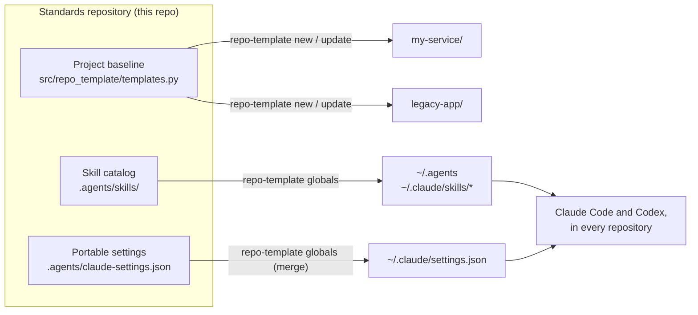
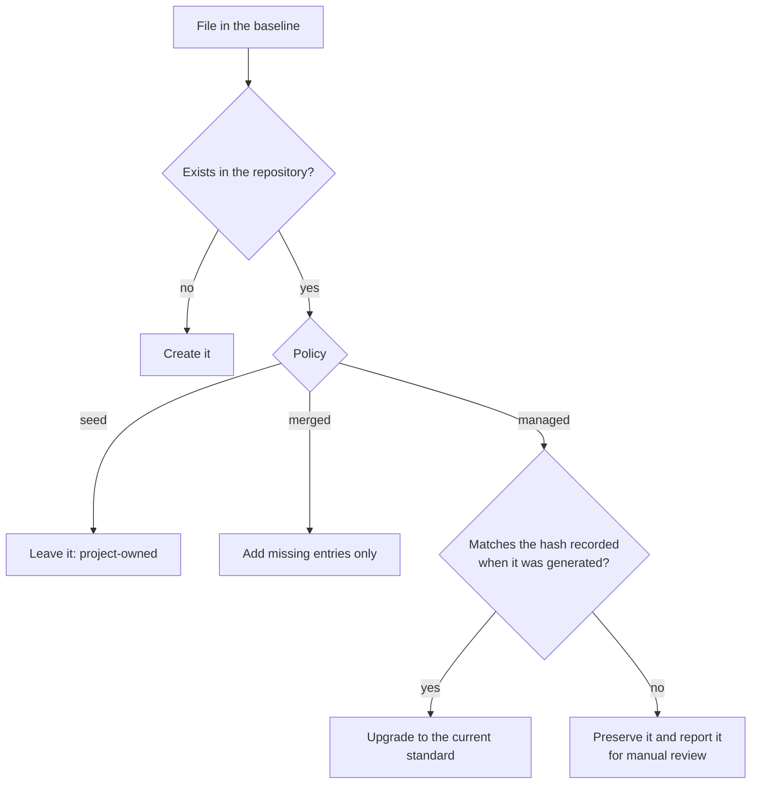
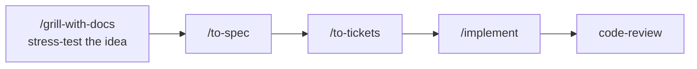

# repo-template

**One standard for every repository you start and every machine you code on, built so AI coding
agents (Claude Code, Codex) find what they need and do their best work.**

`repo-template` is two things that belong together:

1. **A CLI that creates and safely updates Python/uv repositories.** A new repository comes out
   ready to work in: uv, pytest, Ruff, strict mypy, CI, Dependabot, a pre-commit secret scan,
   and the context files agents read first (`AGENTS.md`, `GLOSSARY.md`, `docs/adr/`). Existing
   repositories move toward the same standard without losing local changes.
2. **A versioned catalog of agent skills and settings.** `.agents/skills/` holds the skills you
   rely on: test-driven development, bug diagnosis, architecture review, spec → tickets →
   implementation, code review, LangChain/LangGraph, evals and more. One command links them
   into Claude Code and Codex on any machine.

## Why this exists

AI agents are only as good as the repository they land in and the workflows they're given.

- **Agents need context in predictable places.** An `AGENTS.md` with the real commands and the
  system's purpose and boundaries, a `GLOSSARY.md` of domain terms, and ADRs that explain past
  decisions give an agent the context a new teammate would ask for. Skills such as
  `domain-modeling`, `codebase-design`, `improve-codebase-architecture` and `grill-with-docs`
  read and write exactly these files.
  Every generated repository has them.
- **Agents need a fast, strict feedback loop.** `tdd` and `diagnosing-bugs` work only when tests,
  lint and type checks fail loudly. Every repository gets the same `pytest` / `ruff` /
  `mypy --strict` loop, enforced by a pre-commit hook and CI.
- **Copied templates rot.** Cookiecutter-style templates are copied once and then drift.
  `repo-template update` keeps bringing repositories forward, and because it records what it
  generated, it never overwrites a change you made.
- **Skills drift between machines.** Hand-copying `~/.claude/skills` leaves every laptop slightly
  different. Here the catalog is a Git repository: `git pull && repo-template globals` makes
  machines identical, while credentials, history and caches stay local.

## How it works



### Who owns each generated file

Every file in the project baseline has a policy that decides what `update` may do to it.

| Policy | Files | What `update` does |
| --- | --- | --- |
| **Managed** | CI workflow, Dependabot, PR template, pre-commit hook, `.editorconfig`, `.gitattributes`, `.python-version`, `CLAUDE.md` | Upgrades the file to the current standard **only if** it is unchanged since it was generated. Edited files are left alone and reported. |
| **Seed** | `README.md`, `AGENTS.md`, `GLOSSARY.md`, `CHANGELOG.md`, `.env.example`, issue templates, `docs/adr/README.md`, package `__init__.py`, smoke test | Created whenever it is missing (also after you delete it), then the file is yours: `update` never changes one that exists. To delete one for good, add it to `project_owned`. |
| **Merged** | `pyproject.toml`, `.gitignore`, `.vscode/*.json` | Adds what is missing and never removes anything: dev dependencies and tool tables in `pyproject.toml`, a marked block in `.gitignore`, missing keys, extension recommendations and tasks in VS Code files. Project metadata and dependencies are not touched. |

Each generated repository commits a `.repo-template.json` manifest that records the template
version, the project variables, and a SHA-256 of every managed file as generated. That hash is
how `update` tells "unchanged since generation, safe to upgrade" from "you edited this, leave it".



Running `update` a second time changes nothing.

### Global linking: portable files only, never machine state

`repo-template globals`:

- links `~/.agents` → `<standards>/.agents` (Codex and the `npx skills` CLI read global skills
  from here);
- merges the portable settings in `<standards>/.agents/claude-settings.json` into a real
  `~/.claude/settings.json` (see below);
- creates one link per skill that isn't in a skill pack,
  `~/.claude/skills/<name>` → `<standards>/.agents/skills/<name>`, and removes links to skills
  that were deleted or moved into a pack;
- keeps this repository's `.claude/skills/` mirror in step with the catalog (relative links, so
  they work on every machine);
- adds `.agents/`, `.claude/` and `.codex/` to your global Git ignore, so personal agent
  configuration never leaks into project repositories.

It never links `~/.claude` itself, so credentials, sessions, history, caches and Claude's
`synced` directory stay on the machine. Anything it replaces is first moved to
`~/.repo-template/backups/<timestamp>/`.

### Portable settings: merged, not linked

`.agents/claude-settings.json` has three parts:

- `portable`: owned by repo-template and kept current on every machine, entry by entry. Each
  plugin switch, environment variable (telemetry opt-outs) and marketplace, each permission rule
  (deny reading `.env` and key files at any depth, ask before destructive Docker commands), and
  each hook, identified by its event, matcher and command (the skill receipts, which always end
  in `|| true`).
- `defaults`: model, effort level, theme, notifications (only machine preferences are accepted
  here). Each one is written once, when a machine doesn't have it, and never again: after that it
  belongs to the machine (`/model` and `/config` write it), even if you remove it.
- `linked`: what the pre-0.4.2 link distributed, used once to migrate that link (below).

`globals` merges `portable` into `~/.claude/settings.json` and records what it wrote in
`~/.repo-template/globals-state.json`, so it can tell a change in the standards from a change you
made on this machine:

- an entry still as `globals` wrote it takes the new portable value, including `false` and
  removals;
- an entry you changed here is kept and reported under **Preserved for manual review**, as
  `! … enabledPlugins.<plugin> (changed on this machine; kept)`,
  `! … permissions.deny <rule> (removed on this machine)` or
  `! … hooks.<event> <matcher or *> <command> (changed on this machine; kept)`. That run exits
  `2`; later runs are quiet until the standard's value for that entry changes, which is reported
  once more;
- everything else in the file is never touched: your own plugins, rules and hooks (also hooks
  you add inside a portable matcher group), and values you already had before your first
  `globals` run.

To **change a portable setting for every machine**, edit `.agents/claude-settings.json` here,
commit, then `git pull && repo-template globals` elsewhere. A `/plugin` toggle or a hand edit of
`~/.claude/settings.json` stays on that machine. To **take the standard's value back** for an
entry you changed, set it to the value in `.agents/claude-settings.json` (or re-add the removed
rule): `globals` then treats it as current again. To **start over**, delete
`~/.repo-template/globals-state.json` together with every portable entry (or whole `enabledPlugins`,
`permissions` and `hooks` sections) in `~/.claude/settings.json`; the next run writes them again as
its own. Entries you leave in place after deleting the state file count as this machine's, and
defaults you removed are written again.

`permissions.allow` and settings that widen access to the machine, such as
`remoteControlAtStartup`, are never distributed: `globals` refuses a source that contains them.
A link at `~/.claude/settings.json` that repo-template didn't create (dotfiles, stow) is left
alone and reported once.

#### Upgrading a machine from a linked settings file (before 0.4.2)

Before 0.4.2, `~/.claude/settings.json` was a link to `.claude/settings.json` in this repository,
so Claude Code wrote `/model`, `/effort` and `/plugin` changes from every machine into that shared
file. That file is gone in 0.4.2. On each machine:

```bash
cd /aiDevStandards
cp .claude/settings.json ~/claude-settings-before-0.4.2.json   # this machine's view
git checkout -- .claude/settings.json      # changes Claude Code wrote through the link block the pull
git pull                                   # removes .claude/settings.json: the link now dangles
cp ~/claude-settings-before-0.4.2.json .claude/settings.json   # Git ignores it now
repo-template globals
rm .claude/settings.json
```

Putting the saved copy back before `globals` lets the migration see this machine's settings
through the link. It then backs up that content and the link target under
`~/.repo-template/backups/<timestamp>/`, writes a real file, and keeps everything the old shared
file didn't distribute (your own plugins, rules, hooks, `model`, `remoteControlAtStartup`). If you
skip that step, the dangling link is treated like a fresh machine: every portable entry and
default is written, and nothing of the old file is kept. Between the pull and `globals`, Claude
Code on that machine has no user settings: no deny rules, plugins or receipt hooks.

## Quick start

### Install (once per machine)

Keep this repository at a stable path. On a Mac, `/aiDevStandards` is the recommended
location; on the Linux workstation it lives at `/ai/Moore/repo-template`.

```bash
git clone git@github.com:bennwitt/repo-template.git /aiDevStandards
cd /aiDevStandards
uv tool install --editable .
repo-template globals --standards-root /aiDevStandards --check   # preview
repo-template globals --standards-root /aiDevStandards           # apply
```

Because the install is editable, a `git pull` updates the CLI and its templates without a
reinstall. Set `AI_DEV_STANDARDS=/aiDevStandards` in your shell profile to omit
`--standards-root`. A root named either way must be a standards repository, or the command stops
with an error. Without either, `globals` uses the checkout the CLI is installed from, so running
it inside some other repository (which may well have `.agents/skills/` of its own, from
`npx skills add`) never relinks `~/.agents` there. If you're inside a second
repo-template checkout, it stops and asks you to pass `--standards-root`.

### Create a repository

```bash
repo-template new my-service --parent ~/code --description "Processes customer jobs."
cd ~/code/my-service
uv run pytest
```

`new` normalizes the name (`My Service` becomes the project `my-service` with package
`my_service`), refuses to write into a non-empty directory, runs `git init -b main`, points
`core.hooksPath` at `.githooks/`, and creates `uv.lock`. `--python 3.13` changes the Python
version (default `3.12`). Use `--no-git` or `--no-lock` only when another system owns those
steps.

### Bring an existing repository up to standard

```bash
repo-template check  /path/to/repo   # dry run: lists what would change, writes nothing
repo-template update /path/to/repo   # apply, then decide each file that differs
repo-template check  ~/code/*/       # several repositories: one summary line each
```

`update` creates what's missing, merges `pyproject.toml`, `.gitignore` and the VS Code files,
configures the Git hook path (skip with `--no-hooks`), and creates or refreshes `uv.lock` when
`pyproject.toml` changed (skip with `--no-lock`). `check` plans the same steps and also reports
`.repo-template.json` when it is out of date (a new template version, a stale hash), so a clean
`check` means `update` has nothing to do. While other files are out of date too, it lists the
manifest whenever its hashes would change.

A manifest written by a newer `repo-template` than the one you're running stops both commands:
`git pull` the standards repository first, so an out-of-date machine can't downgrade a repository.

#### Deciding files that differ

A file that exists and differs from the baseline is never changed silently. In a terminal,
`update` shows a diff of yours against the baseline and asks what to do:

| Choice | Effect |
| --- | --- |
| `o` use the baseline | Replace your file with the baseline's version. |
| `k` keep yours | Keep it, and record in `.repo-template.json` that you accepted this difference. You're asked again only when the baseline's version of the file changes. |
| `m` merge change by change | For each place the two differ: take the baseline's (`y`), keep yours (`n`), or keep both (`b`). A result that differs from the baseline is recorded like `k`. |
| `a` always keep yours | Add the file to `project_owned` in `.repo-template.json`; `update` leaves it alone for good, and doesn't recreate it if you delete it. |
| `s` skip for now | Leave it; `update` asks again next time. |

A merged file that `update` can't merge into (`pyproject.toml` or `.vscode/*.json` that doesn't
parse) offers only keep, always keep or skip: the baseline's version of it is a bare template that
would replace your project's metadata and dependencies, or your editor settings. Fix it by hand
and run `update` again.

A file under an old name (`CONTEXT.md` is now `GLOSSARY.md`, and a `CLAUDE.md` holding the agent
guide moves to `AGENTS.md`) can be moved for you: with `git mv` when the file is tracked, so its
history follows. `update` then lists the lines that still mention the old name. Commit the
staged moves on their own before anything else to keep that history.

Every decision is applied as you make it, so stopping halfway (Ctrl-C) loses nothing. Without a
terminal (scripts, CI, agents), or with `--no-input`, `update` lists the files under
**Preserved for manual review** and exits with `2`; the `repo-template` skill walks an agent
through the same decisions.

#### Adopting a repository the baseline didn't generate

`update` infers the name, description and Python version from `pyproject.toml`, and adapts to
what is already there:

- code that lives in `src/` but not in `src/<package>/` keeps its layout: no package scaffold,
  smoke test or `[tool.mypy]` table that would name a package the repository doesn't have;
- a tool the project already configures (any `[tool.ruff…]`, `[tool.pytest…]` or `[tool.mypy]`
  table) keeps its settings, since adding even a line length changes how it formats code;
- a `CLAUDE.md` that holds the agent guide is offered a move into `AGENTS.md`, instead of
  `update` creating a generic `AGENTS.md` beside it;
- every managed file that differs comes up for a decision, because there's no generation hash
  to prove it unedited.

### Exit codes

| Command | `0` | `1` | `2` |
| --- | --- | --- | --- |
| `new` | created | created, but a Git or uv step failed | n/a |
| `update` | applied cleanly | an error was reported: a Git or uv step failed, or a listed skill pack isn't defined or lists a skill that isn't installed | files preserved for manual review |
| `check` | current (every path, when given several) | something would change, or an error was reported | n/a |
| `globals` | applied cleanly | an error was reported (for example an override for a missing skill, or settings that aren't valid JSON) | something was preserved: a portable setting changed on this machine (reported once), a link at `~/.claude/settings.json` that repo-template didn't create, or a real folder in this repository's `.claude/skills/` mirror where a skill link belongs |
| `globals --check` | current | a link or setting would change, or something is reported for review (once: a setting changed on this machine, a link repo-template didn't create) | n/a |

Every command also exits `1` with a `repo-template: error: …` line when it can't run at all: an
unknown pack, an unreadable manifest, a non-empty target for `new`, or a manifest from a newer
version. Exit `2` otherwise means only "preserved for manual review" (and command-line usage
errors, which print the usage). When a run has both errors and preserved files, errors win and
the exit is `1`: fix what failed, rerun, then decide the preserved files.

With several paths, `check` prints one line per repository on stdout, such as
`../svc: current (0.4.1)` or `../api: 1 to create, 2 to update, 1 for review (0.3.0)` (the
version recorded in its manifest), and each error as a `repo-template: error: <path>: …` line on
stderr.

This makes the CLI easy to script, for example `repo-template check . || echo "standards drifted"`.

## What a generated repository contains

```text
my-service/
├── AGENTS.md              # purpose, boundaries, commands and working agreements for any agent
├── CLAUDE.md              # "@AGENTS.md": Claude reads the same guide as Codex
├── GLOSSARY.md            # domain terms only, kept by the domain-modeling skill
├── docs/adr/              # architecture decision records
├── README.md, CHANGELOG.md
├── pyproject.toml         # uv_build, pytest, Ruff, mypy --strict
├── src/my_service/        # __init__.py, py.typed
├── tests/test_smoke.py
├── .githooks/pre-commit   # secret scan, uv lock --check, ruff, mypy, pytest
├── .github/               # CI, Dependabot (uv and Actions), PR and issue templates
├── .vscode/               # interpreter, pytest, Ruff on save, tasks
├── .env.example           # .env, *.pem and *.key are ignored
├── .ai/receipt-policy.json # turns on skill receipts (see below)
└── .repo-template.json    # ownership manifest: commit it
```

## The skill catalog

Skills live in `.agents/skills/<name>/SKILL.md`. `.claude/skills/` in this repository is a mirror
of symlinks, so the same skills appear when you open this repository in Claude Code.

A skill with `disable-model-invocation: true` runs only when you type `/name`, so it costs no
context until you use it. The others are listed in every session so the agent can pick them up
on its own. Claude Code's `/skill-doctor` shows each skill's per-turn context cost and how often
it is used; run it occasionally and prune what you never use.

### Engineering workflow (mattpocock/skills)

A typical feature moves through these skills:



| When you want to… | Use |
| --- | --- |
| Bring a repository to this standard | `repo-template` (check, update, resolve preserved files, packs) |
| Find the right skill or flow | `/ask-matt` |
| Stress-test a plan | `grilling`, `/grill-me`, `/grill-with-docs` (also writes ADRs and glossary terms) |
| Turn a discussion into work | `/to-spec`, `/to-tickets`, `/wayfinder` (work larger than one session) |
| Build | `/implement`, `/implement-spec`, `tdd`, `prototype` |
| Fix a hard bug or regression | `diagnosing-bugs` |
| Improve structure | `/improve-codebase-architecture`, `codebase-design`, `domain-modeling` |
| Review changes | `code-review` (against repository standards and against the spec) |
| Describe a PR | `pr` |
| Manage issues | `/triage`, `/to-questionnaire` |
| Pause and resume | `/handoff`, `/claude-handoff` |
| Write | `writing-for-agents`, `/writing-fragments`, `/writing-shape`, `/writing-beats` |
| Research, learn, reflect | `research`, `/teach`, `/loop-me`, `/retro` |
| Steps only a human can do | `wizard` |

Run `/setup-matt-pocock-skills` once in each repository. It records where issues are tracked,
the triage label names, and the domain-doc layout in `docs/agents/*.md`, which `to-spec`,
`to-tickets` and `triage` read.

### Other global skills

| Area | Skills | Source |
| --- | --- | --- |
| Python tooling | `uv`, `ruff` | astral-sh/claude-code-plugins |
| Testing | `property-based-testing` (Hypothesis and friends; `update` idempotence is a property) | trailofbits/skills |
| Security | `supply-chain-risk-auditor` (dependency and lockfile risk), `github-actions-hardening` (workflow review, SHA pins) | trailofbits/skills, github/awesome-copilot |
| Pull requests | `pr` (PR body with evidence, blast radius and rollback) | mattpocock/skills |
| Skill hygiene | `skill-scanner` (vet a third-party skill before adding it), `find-skills` | getsentry/skills, vercel-labs/skills |
| Agent and Git safety | `git-guardrails-claude-code`, `resolving-merge-conflicts` | mattpocock/skills |

### Skill packs: domain skills only where they apply

A skill's description is listed in every session, so a LangChain skill costs context in a repository
that has nothing to do with LangChain, and its broad triggers can fire there. Skills that only make
sense in some repositories are grouped into packs in `.agents/skill-packs.json`. `globals` doesn't
link pack skills into `~/.claude/skills`; a repository opts in instead:

```bash
repo-template new my-agent --pack langchain        # start with a pack
repo-template update /path/to/repo --pack gradio   # add one later (also applies the baseline)
```

The pack is recorded under `skill_packs` in `.repo-template.json`, and `update` links each of its
skills into the repository's `.claude/skills/` (ignored by Git) as links to `~/.agents/skills/`.
To drop a pack, remove it from `skill_packs` and run `update`; its links are removed and nothing
else in `.claude/skills/` is touched. On another machine, `update` recreates the links. If
`skill_packs` lists a pack that `skill-packs.json` no longer defines (renamed, or a machine that
hasn't pulled), `update` reports it and removes no links at all, since it can't tell which ones
belonged to that pack.

| Pack | Skills | Source |
| --- | --- | --- |
| `langchain` | `ecosystem-primer` (start here), `langchain-*`, `langgraph-*`, `deep-agents-*`, `deepagents-*-quickstart`, `managed-deep-agents`, `langsmith-online-eval-engineering` | langchain-ai/langchain-skills |
| `agent-evals` | `eval-engineering` | langchain-ai/langchain-skills |
| `gradio` | `gradio`, `hf-gradio` | gradio-app/gradio |
| `knowledge-graph` | `knowledge-graph-extraction` | local |
| `typescript` | `setup-ts-deep-modules`, `migrate-to-shoehorn` | mattpocock/skills |

Claude Code plugins (skill-creator, GitHub, Playwright, hookify, and others) are enabled through
the portable settings in `.agents/claude-settings.json` rather than vendored here.

### Skill receipts

Every generated repository has `.ai/receipt-policy.json`. It turns on a record of which skills
ran there:

```json
{"mode": "announce", "logPath": ".ai/skill-receipts.jsonl"}
```

The portable Claude settings register `.agents/hooks/skill_receipt.py` for two hook events:
`PostToolUse` on the `Skill` tool (the model or a subagent used a skill) and `UserPromptExpansion`
(you typed `/skill-name`). Each use appends one line to the log:

```json
{"time": "2026-10-01T20:26:36+00:00", "skill": "tdd", "trigger": "user", "source": "userSettings", "session": "…", "args": "add login"}
```

`mode` is `off`, `log` (append only) or `announce` (append and show a one-line notice in the
session). Repositories without a policy file are ignored, the log is ignored by Git, and the hook
always exits cleanly, so it can never block a session. Receipts cover Claude Code only; Codex has
hooks, but no event that reliably identifies a skill.

### Add, update, or remove a skill

Because `~/.agents` points at this repository, the `npx skills` CLI installs global skills
straight into the catalog:

```bash
npx skills find changelog                                    # search https://skills.sh
npx skills add owner/repo --skill some-skill -g -a claude-code codex
uv run .agents/skills/skill-scanner/scripts/scan_skill.py .agents/skills/some-skill
repo-template globals            # links it for Claude and adds the repository mirror link
uv run pytest                    # validates every SKILL.md and the mirror
git add .agents/skills/some-skill .claude/skills/some-skill
git commit -m "Add some-skill skill"
```

To change a vendored skill's description or other frontmatter, don't edit its `SKILL.md`:
`npx skills update` would overwrite the edit. Add it to `.agents/skill-overrides.json` with a
`why`, and `repo-template globals` re-applies it after every update (a test fails until it does):

```json
{"langchain-rag": {"why": "Upstream triggers on any RAG work.", "frontmatter": {"description": "…"}}}
```

`npx skills` records each skill's source in `.agents/.skill-lock.json`, which is committed, so
every machine can update from the same sources. On every other machine, run
`git pull && repo-template globals`. To remove a skill, delete its
folder and run `repo-template globals`, which removes the stale links. `npx skills update -g`
refreshes installed skills from their sources. To write a new skill, use the `skill-creator`
plugin, and follow `writing-for-agents`.

## Safety guarantees

- An edited file is never overwritten. It is reported for review and `update` exits with `2`.
- `update` is idempotent: a second run changes nothing.
- `check` and `globals --check` never write.
- Files are written atomically (temporary file, then rename).
- Global files are backed up before being replaced with links.
- `~/.claude` is never linked wholesale: individual skills are linked, and the portable settings
  are merged into `~/.claude/settings.json`, entry by entry, keeping changes made on the machine.
- Generated repositories ignore `.env`, `.env.*`, `*.pem`, `*.key`, `.agents/`, `.claude/` and
  `.codex/`. The pre-commit hook blocks staged private keys and AWS- or OpenAI-style keys.
- The CLI never creates GitHub repositories, pushes commits, or copies secrets.

## Current limitations

- New repositories don't yet include the `docs/agents/*.md` files the engineering skills expect;
  run `/setup-matt-pocock-skills` after `new`.
- Skill packs scope skills for Claude Code only. Codex reads every skill in `~/.agents/skills`,
  so it still sees pack skills everywhere.
- Python/uv is the only project profile.

## Developing this repository

```bash
uv sync --dev
uv run pytest
uv run ruff check .
uv run mypy src
uv run repo-template --help
```

- Template content: `src/repo_template/templates.py`, one `add()` call per file with its policy.
- What each policy may do to a file (managed, seed, merged): `src/repo_template/policies.py`,
  one class per policy behind a single `decide` interface. Applying them to a repository and
  writing the manifest: `src/repo_template/scaffold.py`. Portable settings merge, its state file
  and the migration from the old link: `src/repo_template/settings.py`. Hook path and lockfile,
  shared by `new`, `update` and `check`: `src/repo_template/repository.py`. Global linking:
  `src/repo_template/standards.py`.
- This repository is the first consumer of its own baseline: it commits a `.repo-template.json`
  and `tests/test_baseline_sync.py` fails whenever `repo-template check .` would change anything,
  or the build pins differ. A Dependabot update here therefore fails CI until `templates.py`
  catches up.
- When you change generated content, bump the version in `pyproject.toml` and
  `src/repo_template/__init__.py`, add a `CHANGELOG.md` entry, and add tests for any change to
  rendering, conflict handling or symlink behaviour. Then run `uv run repo-template update .` and
  commit the refreshed `.repo-template.json` (and `uv.lock`) with the bump:
  `tests/test_baseline_sync.py` fails until this repository's manifest records the new version.
- `GLOSSARY.md` defines the domain terms used here, such as standards repository, project
  baseline, managed file, seed file, portable global, machine state and skill receipt.
